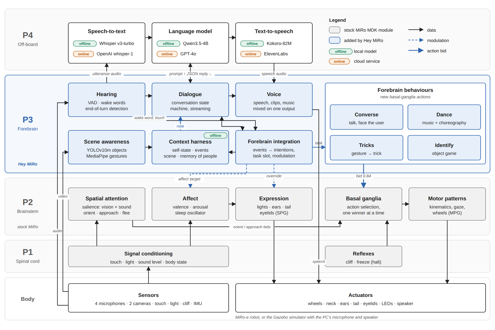
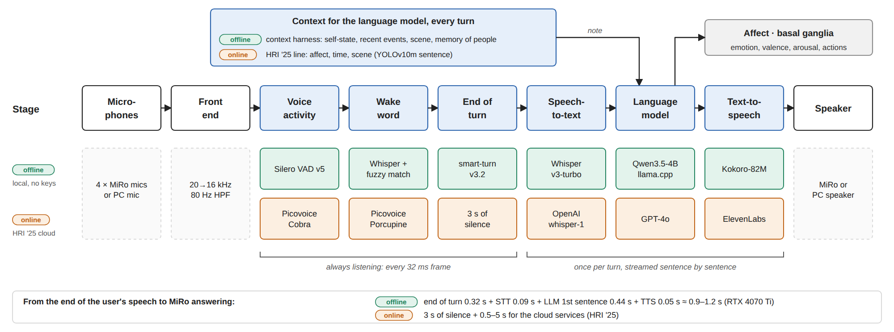
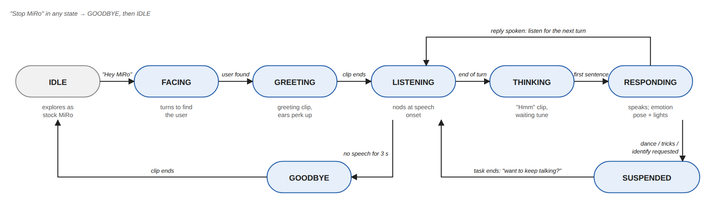
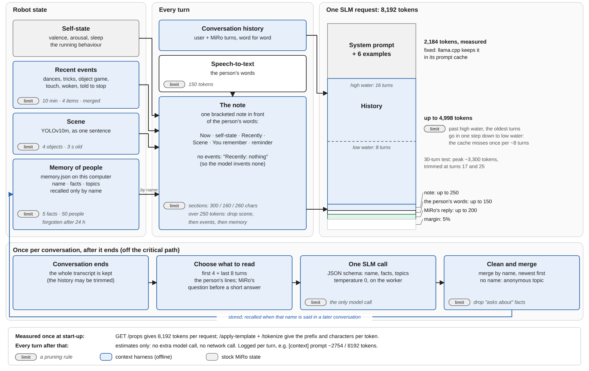
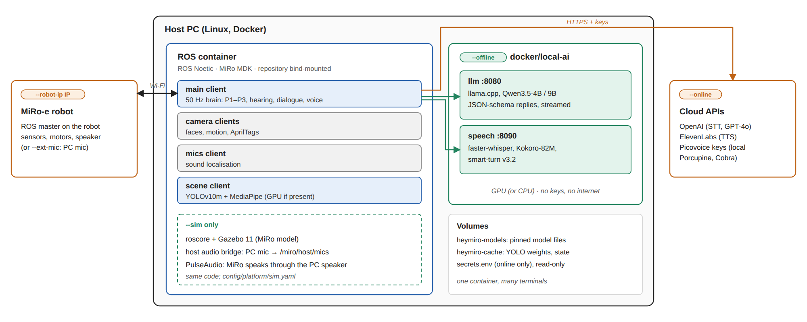

# Hey MiRo! An extended cognitive architecture for MiRo-e

This repository holds the code for **"Hey Miro! Multimodal Interaction with an Animal-like Robot Companion with
Conversational Abilities"** (Htet, Bernacka, Marei, Holden & Prescott, HRI '25). It extends the layered,
brain-inspired control system of the MiRo-e robot (Mitchinson & Prescott, 2016) with new **forebrain** components:

- **Spoken conversation:** wake word, listening, speech-to-text, a language model and MiRo's own voice.
- **Scene awareness:** YOLO object detection and mediapipe hand gestures.
- **Behaviours triggered by speech:** spinning, ear wiggles, an impression, dancing to music, tricks and an object
  game.

Every behaviour competes through MiRo's basal-ganglia action selection and modulates its affect, so MiRo keeps all
of its animal-like behaviour and language is one more source of goals.

The demo runs in **two versions** and on **two platforms**. You choose each with a flag:

|  | **Simulator** (Gazebo, your PC's mic and speaker) | **Robot** (a physical MiRo-e) |
|---|---|---|
| **Offline**: local models only, no keys, no internet | `run.sh --sim --offline` | `run.sh --robot --offline` |
| **Online**: the original HRI '25 cloud pipeline | `run.sh --sim --online` | `run.sh --robot --online` |

**Contents**

1. [Architecture and pipeline](#1-architecture-and-pipeline)
2. [Requirements](#2-requirements)
3. [Setup (once per computer)](#3-setup-once-per-computer)
4. [Offline setup](#4-offline-setup-local-models)
5. [Online setup](#5-online-setup-cloud-services)
6. [Run in the simulator](#6-run-in-the-simulator)
7. [Run on the robot](#7-run-on-the-robot)
8. [Switching: offline/online, simulator/robot](#8-switching-offlineonline-simulatorrobot)
9. [Configuration](#9-configuration)
10. [Testing](#10-testing)
11. [Repository layout](#11-repository-layout)
12. [Troubleshooting](#12-troubleshooting)
13. [Citation and credits](#13-citation-and-credits)

The design of every stage, the models and why they were chosen, the benchmarks, and a behaviour-by-behaviour
comparison with the original HRI '25 code are in [docs/TECHNICAL.md](docs/TECHNICAL.md).

---

## 1. Architecture and pipeline

Paper-ready versions of every figure (SVG, PDF and PNG) are in [docs/figures/](docs/figures/). They are drawn by
`docs/figures/make_figures.py`, and `docs/figures/render.bash` regenerates them after an edit.

### The architecture



**Figure 1. The Hey MiRo cognitive architecture.** MiRo's stock control system (grey) is layered like the
vertebrate nervous system (Mitchinson & Prescott, 2016):

- **P1, the spinal cord:** signal conditioning and reflexes.
- **P2, the brainstem:** affect, spatial attention, expression, and basal-ganglia action selection.

Hey MiRo adds:

- **P3, a forebrain (blue):**
  - hearing, dialogue and voice;
  - scene awareness;
  - the **context harness** (offline), which tells the small language model about MiRo's state, recent events
    and the people it has met;
  - an integration node that turns events into intentions;
  - four new behaviours (converse, dance, tricks, identify).
- **P4, an off-board layer** of speech and language models.

The forebrain does not replace the lower layers. It **modulates** them: it sets an affect target, borrows the
expression channels, and enters its behaviours as **bids** to the stock basal ganglia, which still arbitrate every
action. Reflexes such as cliff avoidance therefore always win. P4 is the only layer that differs between the two
versions: local models (offline) or cloud services (online).

### The conversation pipeline



**Figure 2. The conversation pipeline and its two implementations.**

- The first three stages run continuously on every 32 ms audio frame. The speech-to-text, LLM and text-to-speech
  stages run once per turn.
- Every turn, the LLM also receives a context note:
  - offline, from the [context harness](#the-context-harness-offline): self-state, recent events, scene and
    memory;
  - online, the HRI '25 line: affect, time and scene.

  It returns MiRo's emotion and actions along with its reply.
- The offline version replaces the fixed 3 s silence with a learned end-of-turn model, and streams the reply
  sentence by sentence. This is why it answers in about 1 s instead of 3.5–8 s.

Each stage is implemented differently in the two versions:

| Stage | **Offline** (`ai.provider: local`) | **Online** (`ai.provider: cloud`, HRI '25) |
|---|---|---|
| Voice activity detection | Silero VAD (CPU, in the ROS container) | Picovoice Cobra |
| Wake words | local Whisper, fuzzy match of "Hey / Dance / Stop MiRo" | Picovoice Porcupine (`assets/wakewords/*.ppn`) |
| End of turn | smart-turn v3.2: MiRo answers 0.3–1.2 s after you finish | a fixed ~3 s of silence |
| Speech-to-text | faster-whisper large-v3-turbo (GPU) | OpenAI Whisper (`whisper-1`) |
| Language model | Qwen3.5-4B (or 9B) on llama.cpp, JSON-schema constrained, streamed | GPT-4o (JSON mode) |
| Text-to-speech | Kokoro-82M, first sentence plays while the rest is generated | ElevenLabs |
| Object game comment | the local LLM | GPT-4o-mini |
| Objects and gestures | YOLOv10m + mediapipe, local in both versions | same |
| Songs | bundled mp3s with measured tempo, in both versions | same (Spotify lookup optional) |
| Needs | an NVIDIA GPU (8 GB+) is best; CPU works with ~15 s answers | API keys and internet |

### The conversation



**Figure 3. The dialogue state machine** (`core/forebrain/dialogue.py`). Each state also sets MiRo's pose, lights
and affect. A dance, trick or object game requested in conversation suspends the dialogue, which resumes when the
task ends.

### The context harness (offline)

A 4-billion-parameter model knows nothing about the robot it speaks for. It only knows what is in its prompt. The
**context harness** (`src/heymiro/core/context/`) builds that prompt on every turn. It puts one bracketed note in
front of the person's words, made from MiRo's own state:

```
[Now: Monday 17 November 2026, 14:32. You are awake and feeling happy (valence 0.80, arousal 0.70).
 Recently: you danced to Dancing Queen by ABBA (2 minutes ago); someone scratched your tail (40 seconds ago).
 Your camera sees: a person in front of you.
 You remember Sam (you last talked an hour ago): has a dog called Max; loves ABBA. Last time you talked about dogs and ABBA.
 Choose actions from the upcoming message only, and answer in the JSON format given.]
Hi MiRo, it's Sam again!
```

| Section | Comes from | Lets MiRo |
|---|---|---|
| **Self-state** | affect (valence, arousal, sleep), the running behaviour | say how it feels and what it is doing |
| **Recent events** (`context/events.py`) | the forebrain and the behaviours log what the body did: dances (with the song), tricks, the object game, being stroked or scratched, being woken, being told to sleep or stop. When nothing happened, the note says so, so the model does not make something up | answer "what did you just do?" truthfully |
| **Scene** | YOLO, as one sentence | talk about what it sees |
| **Memory** (`context/memory.py`) | past conversations, condensed by the SLM itself | greet a returning person by name and remember what they said |



**Figure 5. The context harness.**

- **Left:** where the note's sections come from.
- **Middle:** how the note is assembled on every turn.
- **Right:** how one 8,192-token request is divided.
- **Bottom:** the memory loop that runs once per conversation.
- **Grey "limit" pills:** every pruning rule.

**How the memory works:**

1. When a conversation ends, the SLM reads the transcript in one extra call. The call is constrained by a JSON
   schema and runs in the background, so it does not slow MiRo down.
2. It writes down the person's name, up to 5 facts they said about themselves, and the topics.
   - It reads only the person's own lines, plus MiRo's question before a short answer such as "Yes, two!".
   - So MiRo's own likes can never become facts about the person.
3. Later, if someone says a stored name, that person's record goes into the note for the rest of that
   conversation.
4. MiRo cannot recognise faces or voices, so **recall works only by name**. Without a name, MiRo never claims to
   know someone.

**Design for a small model:**

- The system prompt and the examples stay first and never change, so llama.cpp's prompt cache keeps them. The
  note comes last and costs only about 100 tokens. Each section has a length cap, and empty sections are left
  out.
- The system prompt gets short rules: use the note only when it fits, never read it out, and never claim a memory
  or an event the note does not contain.
- The few-shot examples carry notes in the same format, so the model sees its examples in the form it is asked to
  answer.

**Context budget: the window never overflows, with no extra model calls.** Each request to the SLM has 8,192
tokens: llama.cpp's `--ctx-size 16384` shared by `--parallel 2`. At start-up, MiRo asks llama.cpp once for this
size and for the exact size of the fixed prompt (2,184 tokens). After that, every turn only estimates, which is
instant.

| Part of the request | Budget | How it is kept |
|---|---|---|
| System prompt + examples | 2,184 | fixed; prompt-cached |
| This conversation's history | up to 4,998 | past 16 turns or 4,998 tokens, the oldest turns go **in one step** down to 8 turns |
| Note | 250 | section caps; if still over, drop scene, then events, then memory |
| The person's words | 150 | longer transcripts are cut (≈ 30 s of speech) |
| MiRo's reply | 200 | `llm.max_tokens` |

- **Why trim in one step:** removing one old turn per turn would change the start of the history every turn. The
  prompt cache would then miss each time, which costs seconds on a CPU. Trimming to 8 turns in one go means one
  miss per ~8 turns.
- **Nothing lost to the memory:** the full transcript is kept separately for the memory step, so a name given in
  turn 1 of a long conversation is still remembered.
- **Overflow guard:** if the server ever reports an overflow anyway, the history is trimmed and the turn is
  retried once.
- **Measured in a 30-turn conversation in Gazebo:** the prompt peaked at ~3,300 of 8,192 tokens, trims happened
  at turns 17 and 25, and MiRo kept answering in 1.0–1.3 s. Each turn logs its size, e.g.
  `[context] prompt ~2754 / 8192 tokens (history 8 turns, note 72)`.

**Offline only.** With `--online` the harness is off, and GPT-4o gets exactly the HRI '25 prompt.

**Measured** with `tools/eval_dialogue.py`, 5 rounds on an RTX 4070 Ti:

- The 40 standard cases keep the same quality: 200/200 valid JSON, action F1 0.96 (0.97 without the harness), and
  ~0.45 s to the first sentence.
- The context cases pass 30/30: recent event, no invented events, a touch, the scene, a remembered person, and no
  false memory for a stranger.

**Privacy.** The memory is stored only on this computer, in the `heymiro-cache` Docker volume
(`/root/.cache/heymiro/memory/memory.json`). People are forgotten after `ai.local.context.memory.ttl_hours`
(24 h). To erase everything at once, send the `forget` command, or delete the file. To switch memory off, set
`features.memory: false`. Visitors are often children: keep the time-to-live short and tell people that MiRo
remembers names for the day.

### Where it runs



**Figure 4. Deployment.** One ROS container runs MiRo's brain in both versions and on both platforms. The two
switches change only where its inputs and models come from:

- **Platform:** `--sim` runs Gazebo inside the container and uses the PC's microphone and speaker. `--robot-ip IP`
  uses the ROS master on a physical MiRo-e over Wi-Fi.
- **Version:** `--offline` uses the `docker/local-ai` services on the same PC. `--online` uses the cloud APIs.

In detail:

- **The ROS container** (`docker/run_docker.bash`) runs ROS Noetic, the MiRo MDK, Gazebo and MiRo's brain
  (`src/heymiro`). It is the same for both versions. The code is **bind-mounted** from this repository, so edits
  and `git pull` take effect immediately. Nothing is baked into the image, and there is no `docker commit`.
- **The local AI services** (`docker/local-ai`), offline version only, run in two containers:
  - `llm`: llama.cpp with Qwen3.5, on `127.0.0.1:8080`;
  - `speech`: Whisper, Kokoro and smart-turn, on `127.0.0.1:8090`.
- **The cloud services**, online version only, are reached with the keys in `~/.config/heymiro/secrets.env`.

The online version is the original HRI '25 pipeline, refactored. It keeps the same persona, emotion rules,
voices, clips and behaviours (see [docs/TECHNICAL.md §19](docs/TECHNICAL.md#19-parity-with-the-hri-25-demo-the-online-pipeline)).
The offline version keeps the same behaviours and the same reply format, with local models.

---

## 2. Requirements

- **Ubuntu** 22.04 or 24.04 (other Linux distributions with Docker work too).
- **Docker** with your user in the `docker` group.
- **An NVIDIA GPU with 8 GB or more** for the offline version, plus the
  [NVIDIA Container Toolkit](https://docs.nvidia.com/datacenter/cloud-native/container-toolkit/latest/install-guide.html).
  Docker 25+ can expose the GPU through CDI; no `nvidia` runtime entry is needed. Without a GPU, everything still
  runs on the CPU, with answers taking ~15 s instead of ~1 s.
- **About 40 GB of free disk:** the ROS image is ~11 GB, and the models are ~5 GB (~11 GB with the 9B model).
- **PulseAudio or PipeWire** (the Ubuntu default), a microphone, and **headphones** for the simulator, so MiRo
  doesn't hear itself.
- For the robot: a **MiRo-e** on the same Wi-Fi network as the computer.

---

## 3. Setup (once per computer)

**1. Install Docker** and allow your user to run it, then **log out and back in**:

```bash
curl -fsSL https://get.docker.com | sudo sh
sudo usermod -aG docker $USER
```

**2. Check that Docker can see the GPU** (skip this if you have no NVIDIA GPU):

```bash
docker run --rm --gpus all ubuntu nvidia-smi
```

It should print a table with your graphics card. If it says `could not select device driver`, run:

```bash
sudo nvidia-ctk runtime configure --runtime=docker && sudo systemctl restart docker
```

**3. Get the code:**

```bash
git clone https://github.com/HeyMiro/Ext_Cog_Arch.git
cd Ext_Cog_Arch
git switch improved_version_online_offline
```

**4. Get the environment image** (ROS Noetic, MiRo MDK 2-230105, Gazebo 11 and the Python packages; ~11 GB):

```bash
docker/run_docker.bash --pull
```

`run_docker.bash` picks the image in this order:

1. the one CI published for the checked-out branch, `ghcr.io/heymiro/ext_cog_arch:<branch>`;
2. a local build, `heymiro-env:local`;
3. `:latest`;
4. the last published environment image.

To build the image yourself, run `docker/build_image.bash` (add `--cpu` for a CPU-only torch). The packages on
GHCR may be private; if so, log in first:
`echo <token> | docker login ghcr.io -u <github-user> --password-stdin`, with a token that has `read:packages`.

Then do the setup for the version you want: [offline](#4-offline-setup-local-models),
[online](#5-online-setup-cloud-services), or both.

---

## 4. Offline setup (local models)

**Download the models once** (~5 GB, 5–30 minutes). Everything after this runs without internet:

```bash
docker/local-ai/download_models.bash          # Qwen3.5-4B, Whisper, Kokoro, smart-turn, YOLO weights
docker/local-ai/download_models.bash --9b     # optional: also the larger Qwen3.5-9B
```

The models are free, ungated (no account needed) and pinned to exact revisions in `docker/local-ai/models.env`.
They go into the Docker volume `heymiro-models`; the YOLO weights go into `heymiro-cache`. Re-running the script
only fetches what is missing.

| Job | Model | Licence |
|---|---|---|
| Language model | Qwen3.5-4B Q4_K_M + vision projector (9B optional) | Apache-2.0 |
| Speech-to-text | faster-whisper large-v3-turbo | MIT |
| Voice | Kokoro-82M (`af_heart`, pitched up for MiRo) | Apache-2.0 |
| End of turn | smart-turn v3.2 | BSD-2-Clause |
| Voice activity | Silero VAD v5 (inside the environment image) | MIT |
| Objects | YOLOv10m | AGPL-3.0 |

**Start the services** every time you boot. Either run `docker/run_docker.bash ... --offline`, which does this for
you, or start them by hand:

```bash
docker/local-ai/up.bash            # Qwen3.5-4B (leaves room for Gazebo on the GPU)
docker/local-ai/up.bash --9b       # Qwen3.5-9B (robot: no Gazebo on the GPU)
docker/local-ai/up.bash --down     # stop them and free the GPU
```

`up.bash` waits until the models are loaded. If Docker has no usable GPU, it starts the same services on the CPU
with a warning. Check them with `curl -s http://127.0.0.1:8090/health`, which should print
`"ok":true,"device":"cuda"`.

No API keys are used. Spotify is switched off in this version, and the Picovoice wake words and Cobra VAD are
replaced by local models.

---

## 5. Online setup (cloud services)

**Create the secrets file outside the repository** and fill in your keys:

```bash
install -D -m 600 config/secrets.env.example ~/.config/heymiro/secrets.env
nano ~/.config/heymiro/secrets.env
```

| Variable | Used for | Without it |
|---|---|---|
| `OPENAI_API_KEY` | Whisper speech-to-text and GPT-4o | no conversation |
| `ELEVENLABS_API_KEY` | MiRo's voice | replies are printed; clips still play |
| `PICOVOICE_ACCESS_KEY` | Porcupine wake words and Cobra VAD | no wake words (use the command topic); energy VAD |
| `PICOVOICE_ACCESS_KEY_HEY_MIRO`, `_DANCE_MIRO`, `_STOP_MIRO` | per-wake-word keys, if the `.ppn` files came from different Picovoice accounts | falls back to `PICOVOICE_ACCESS_KEY` |
| `SPOTIFY_CLIENT_ID`, `SPOTIFY_CLIENT_SECRET` | optional song lookup (`features.spotify: true`) | the bundled song list is used |
| `OPENAI_BASE_URL`, `HEYMIRO_LLM_BASE_URL` / `_API_KEY`, `HEYMIRO_STT_BASE_URL` / `_API_KEY`, `ELEVENLABS_BASE_URL` | other OpenAI-compatible or ElevenLabs endpoints | the official APIs |

A missing key switches its feature off with a warning; it never crashes the demo. Format: `KEY=value`, with no
quotes, no `export`, and comments on their own line only.

**How the keys are kept safe:**

- The file lives outside git (`*.env` is ignored) and is mounted **read-only** at `/run/secrets/heymiro.env`.
- It is never baked into the image, passed with `-e`, put on the ROS parameter server or printed. The status
  banner shows key *names* only.
- CI runs a gitleaks secret scan on every push.
- **The old public image `aung9htet/ros_miro:public` had API keys hard-coded in its source.** Revoke and
  re-create those OpenAI, ElevenLabs, Picovoice and Spotify keys, and make that image private or delete it.
- Never run the launch scripts with `bash -x`, because it prints environment values.

---

## 6. Run in the simulator

The Gazebo simulator has no microphones or speaker. `run.sh --sim` therefore starts `tools/host_audio_bridge.py`.
It publishes your **PC's microphone** on `/miro/host/mics` in MiRo's microphone format, and MiRo speaks through
your **PC's speaker** (PulseAudio is passed into the container). **Wear headphones.**

**1. Open a simulator terminal** in the container. Add `--offline` to start the local models first, or `--online`
to use the cloud:

```bash
docker/run_docker.bash --sim --offline
```

The first call creates the long-lived container `heymiro`. The prompt shows `(heymiro:sim/local)`, followed by a
status box listing the mode, the ROS addresses, the GPU, audio, the AI pipeline and which secrets are set.

**2. Start Gazebo and MiRo's brain** inside the container:

```bash
$HEYMIRO_DIR/run.sh --sim
```

`run.sh` does the following:

1. checks the keys or the local services and prints a short **pre-flight** report;
2. starts `roscore` and Gazebo;
3. waits for the simulated MiRo;
4. starts the mic bridge;
5. starts the camera, sound and scene clients, then the main client.

After 20–60 s the 3D window opens and you see `[forebrain] local llm service ready`. Keep this terminal open.

**3. Talk to it.** Say **"Hey MiRo!"**, then talk normally. Things to try:

- "What's your favourite band?"
- "Can you spin around?"
- "Wiggle your ears!"
- "Do your Mickey Mouse impression!"
- "Can you dance to Dancing Queen?"
- **"Dance MiRo!"**
- **"Stop MiRo!"**

If nobody speaks for about 3 s, MiRo says goodbye and goes back to exploring.

**Stop:** press **Ctrl+C** (this stops everything `run.sh` started). Then `exit`, and run
`docker/local-ai/up.bash --down` to free the GPU. `docker/run_docker.bash --stop` removes the container.

Simulator options: `--no-gazebo` (use a simulator you started yourself), `--no-bridge` (e.g. for the
[fake user](#10-testing)), `--no-speaker`, `--device DEV` (pick the microphone), `--no-cameras`,
`--no-scene`, and `-- ARGS` (passed on to `~/mdk/sim/launch_sim.sh`). In the simulator the following are off:
orienting to sound (a mono PC mic has no direction), touch from the microphones, and AprilTag facing (see
`config/platform/sim.yaml`).

---

## 7. Run on the robot

**Prepare the robot (every time):**

1. Switch MiRo on and connect it to the same Wi-Fi as the computer.
2. In the MiRo app, note **MiRo's IP address** (e.g. `192.168.0.42`).
3. In the MiRo app, **turn Demo mode OFF**. Otherwise MiRo's on-board demo fights this one for the motors.
   `run.sh` warns if it finds one running.
4. Connect a speaker to the **computer** and choose it in *Settings → Sound → Output*. MiRo's own speaker also
   works, but it is quiet: add `voice.backend=miro` to `HEYMIRO_SET`, see [Configuration](#9-configuration).

**1. Open a robot terminal**, with your MiRo's IP address:

```bash
docker/run_docker.bash --robot-ip 192.168.0.42 --offline      # or --online
```

The ROS master is the robot itself (`ROS_MASTER_URI=http://<MiRo IP>:11311`). The computer's own address
(`ROS_IP`) is found automatically from the route to the robot; set it with `--host-ip IP` if that fails. The
prompt shows `(heymiro:robot/local)`.

**2. Start MiRo's brain** inside the container:

```bash
$HEYMIRO_DIR/run.sh --robot              # MiRo's own microphones (quiet rooms)
$HEYMIRO_DIR/run.sh --robot --ext-mic    # the computer's / a USB microphone (noisy rooms, as at the HRI demo)
```

**3. Talk to it.** Stand in front of MiRo and say **"Hey MiRo!"**. If you hold up an AprilTag, MiRo turns
towards you, leans in and listens. Try everything from the simulator list, plus:

- "Do some tricks!" (then show hand signs: open palm, pointing up, victory, "I love you");
- "Guess what I'm holding!" (hold an object up to MiRo's camera).

Stroking MiRo's head or back makes it happy, and scratching its ears or tail makes it say "Ouch!".

For richer conversation on the robot (Gazebo is not using the GPU), use `--offline 9b` after
`download_models.bash --9b`. In our tests it picked actions no better than 4B, and it answers ~0.25 s slower.

---

## 8. Switching: offline/online, simulator/robot

The design follows `MiRo_CAVAA_integration`:

- **one long-lived container** is shared by every terminal;
- **the platform is chosen per terminal** (`docker exec -e MIRO_MODE=...`), so you never restart the container to
  switch;
- `heymiro_env.bash` derives `ROS_MASTER_URI` / `ROS_IP` for that terminal.

| To switch | Do | What changes |
|---|---|---|
| **Simulator → robot** | open a new terminal with `docker/run_docker.bash --robot-ip IP`, then `run.sh --robot` | ROS master moves to the robot; `config/platform/robot.yaml` is used |
| **Robot → simulator** | open a new terminal with `docker/run_docker.bash --sim`, then `run.sh --sim` | local roscore + Gazebo; `config/platform/sim.yaml` is used |
| **Offline → online** | `run.sh --online` (or open the terminal with `--online`) | `ai.provider=cloud`: OpenAI, ElevenLabs, Picovoice |
| **Online → offline** | `run.sh --offline` (or open the terminal with `--offline`, which also starts the services) | `ai.provider=local`: docker/local-ai |
| **Make one the default** | set `ai.provider: local` or `cloud` in `src/heymiro/config/heymiro.local.yaml` | applies to every run without a flag |

How the flags get through:

- `run_docker.bash --offline/--online` exports `HEYMIRO_PROVIDER` into the terminal.
- `run.sh --offline/--online` overrides that, and appends `ai.provider=...` to `HEYMIRO_SET`.
- With neither flag, `ai.provider` in `config/heymiro.yaml` applies (**`local`**).

`run.sh` refuses to start the simulator in a robot terminal, or the other way round, and tells you which command
opens the right one.

The **platform overlay** (`src/heymiro/config/platform/<robot|sim>.yaml`) holds the only settings that differ:

| Setting | Robot | Simulator |
|---|---|---|
| `hearing.input_topic`, `salience_topic` | `sensors/mics` (MiRo's ears; `--ext-mic` → `host/mics`) | `host/mics` (the PC mic bridge) |
| `mdk.demo_flags` | `vx` (MiRo's hum off, AprilTag responses off) | `vxS` (also: no orienting to sound) |
| `hearing.self_hearing_guard_s` | 0.3 s | 0.6 s (the PC speaker is close to the PC mic) |
| `hearing.touch_from_mics` | true (ear/tail scratch from mic noise) | false |
| `converse.face_user` | `apriltag` | `none` |
| `scene.rate_hz` | 5 | 1 (leave CPU for Gazebo) |

At start-up, `client_demo.py` also checks the simulator flag in `sensors/package` and warns if it doesn't match
`platform`.

---

## 9. Configuration

All settings are in `src/heymiro/config/heymiro.yaml`, with comments. Later sources win:

1. `config/heymiro.yaml`: shared settings, with robot defaults.
2. `config/platform/<robot|sim>.yaml`: chosen by `run.sh --robot/--sim`, i.e. `$HEYMIRO_PLATFORM`, else
   `$MIRO_MODE`, else robot.
3. `config/heymiro.local.yaml`: your personal tweaks (gitignored); only the keys you change.
4. The YAML file named by `$HEYMIRO_CONFIG`.
5. `$HEYMIRO_SET="a.b=c;d.e=f"`: one-off overrides, e.g.
   `HEYMIRO_SET="voice.backend=miro" $HEYMIRO_DIR/run.sh --robot`.

With `ai.provider: local`, the values in `ai.local.settings` replace the cloud `llm` / `stt` settings.

| Most-used keys | Default | Meaning |
|---|---|---|
| `ai.provider` | `local` | `local` (offline) or `cloud` (online) |
| `ai.local.wake_word`, `vad`, `end_of_turn` | `asr`, `silero`, `smart_turn` | offline listening stack (`porcupine` / `cobra` / `silence` bring back the HRI '25 behaviour) |
| `ai.local.voice`, `pitch`, `speed` | `af_heart`, 1.15, 1.05 | MiRo's Kokoro voice |
| `ai.scene_context` | true | while talking, YOLO tells the LLM (as text) what the camera sees |
| `features.context`, `features.memory` | true, true | offline only: the [context harness](#the-context-harness-offline) and its memory of people |
| `ai.local.context.events.max_age_s`, `max_items` | 600, 4 | how far back "Recently: ..." looks |
| `ai.local.context.memory.ttl_hours`, `max_people`, `max_facts` | 24, 50, 5 | how long and how much MiRo remembers |
| `ai.local.context.budget.reserve_user`, `reserve_note`, `high_turns`, `low_turns` | 150, 250, 16, 8 | the [context budget](#the-context-harness-offline) (the window size is measured from llama.cpp) |
| `features.*` | | switch behaviours on or off: `conversation`, `wake_word`, `dance`, `tricks`, `identify`, `touch_reactions`, `purr`, `sleep_command`, `context`, `memory`, `spotify`, `log_transcripts` |
| `voice.backend`, `device`, `volume` | `host`, default, 1.0 | `host` = the PC speaker; `miro` = MiRo's own speaker (8 kHz) |
| `hearing.end_silence_s`, `no_speech_timeout_s` | 3.0, 3.0 | silence that ends an utterance (online) and that ends the conversation |
| `llm.model`, `tts.voice_id` | `gpt-4o`, ElevenLabs voice | online models |
| `llm.event_name` | the Festival of Mind | inserted into the persona |
| `scene.device`, `yolo_weights` | `auto`, `yolov10m.pt` | YOLO on GPU/CPU |

Other files in `config/`:

- `persona.md`: MiRo's personality.
- `clips.yaml`: the pre-recorded voice clips.
- `songs.yaml`: the songs MiRo can dance to, with title, artist, aliases, bpm and genre.

**Commands without speaking**, from a second terminal:

```bash
rostopic pub -1 /miro/core/forebrain/command std_msgs/String "data: 'dance abba'"
```

The available commands:

| Command | MiRo does |
|---|---|
| `converse` | starts a conversation |
| `dance [song]` | dances, to that song if you name one |
| `tricks` | does tricks |
| `identify` | plays the object game |
| `say TEXT` | says the words |
| `stop` | stops everything |
| `forget` | erases the context harness's memory of people and recent events |

---

## 10. Testing

The unit tests guard every module, and three evaluation tools measure the offline pipeline:

- one stage at a time (`bench_pipeline.py`);
- the language model with the context harness (`eval_dialogue.py`);
- the whole robot in the simulator (`fake_user.py`).

The test speech is synthesised with a Kokoro voice that differs from MiRo's, so the right transcript is always
known.

All of these run inside the container (`cd $HEYMIRO_DIR`).

| What | Command | Needs |
|---|---|---|
| **Unit tests** (~330; ROS, keys, GPU and audio are stubbed) | `python3 -m unittest discover -s tests` | nothing |
| **Pre-flight**: platform, pipeline, missing keys, local services | `python3 tools/preflight.py` (run automatically by `run.sh`) | — |
| **LLM evaluation**: 40 scripted messages through the real prompt, schema and parser; JSON validity, action precision/recall/F1, latency; offline, also 6 context-harness cases (events, scene, memory, no invention) | `python3 tools/eval_dialogue.py` (`--repeat N`, `--json out.json`) | offline services, or `HEYMIRO_SET=ai.provider=cloud` + keys |
| **End-to-end fake user**: a Kokoro voice talks to MiRo over `host/mics` (wake → question → spin → dance → stop, or your own `--script`) and prints how fast MiRo reacted | terminal 1: `./run.sh --sim --no-bridge`; terminal 2: `python3 tools/fake_user.py --play` | offline services, simulator |
| **Stage benchmarks**: VAD, turn, wake, STT, LLM, TTS, YOLO and gesture, with added noise | `python3 tools/bench_pipeline.py --only stt,llm` | offline services |
| **Microphone check**: level meter, recording, offline wake-word test | `python3 tools/mic_check.py --topic host/mics` | a microphone |
| **Environment smoke test** (image build) | `docker/build_image.bash --test` | — |

Typical results on an RTX 4070 Ti, offline version:

- `eval_dialogue.py`: 40/40 valid JSON, F1 ≈ 0.96–0.98, ~0.45 s to the first sentence; context cases 6/6.
- `fake_user.py`: MiRo reacts 0.4–1.8 s after the user stops speaking.

CI (`.github/workflows/ci.yml`) runs the unit tests on Python 3.8, shellcheck, a build of the local-AI speech
image and the secret scan. `docker-image.yml` builds and publishes the environment image when `docker/` changes.

---

## 11. Repository layout

```
README.md                    this guide
config/secrets.env.example   template for API keys (online version); copy it to ~/.config/heymiro/secrets.env
docker/
  Dockerfile, build_image.bash   the environment image (ROS Noetic, MiRo MDK, Gazebo, Python packages)
  run_docker.bash                open a terminal in the container: --sim | --robot-ip IP, --offline | --online
  heymiro_env.bash               per-terminal ROS network setup (bind-mounted), status banner
  entrypoint.sh, smoke_test.sh, asound.conf, requirements.txt, constraints.txt, mdk/
  local-ai/                      the offline models: compose.yaml (+ compose.cpu.yaml), up.bash,
                                 download_models.bash, models.env (pinned revisions), speech/ (Whisper, Kokoro, smart-turn)
docs/TECHNICAL.md            how every stage works, models, prompt design, benchmarks, HRI '25 parity
src/heymiro/                 the demo (bind-mounted at /root/mdk/catkin_ws/src/heymiro = $HEYMIRO_DIR)
  run.sh                     launcher: --sim | --robot, --offline | --online
  config/                    heymiro.yaml, platform/{robot,sim}.yaml, persona.md, clips.yaml, songs.yaml
  core/                      MDK demo brain + forebrain: client_demo.py, node_*.py, action/, forebrain/,
                             choreography/, cloud/ (LLM, STT, TTS clients for both versions),
                             context/ (the SLM context harness: events, memory, per-turn note), heymiro_config.py
  assets/                    voice clips, songs, wake words (.ppn), gesture model
  tools/                     host_audio_bridge.py, preflight.py, fake_user.py, eval_dialogue.py,
                             bench_pipeline.py, mic_check.py, make_clip.py, estimate_bpm.py, demo_launch.bash
  tests/                     unit tests
```

**What changed from `main`.** `main` has a `docker_file/` folder whose `run_docker.bash` hard-codes a host path.
There, the code lived inside the public `aung9htet/ros_miro:public` image, `docker commit` saved changes, and the
API keys were in the source. This version changes that:

- the code lives in git and is bind-mounted into the container;
- the keys are in a read-only secrets file;
- the separate robot and simulator copies of the code are now one package, with a platform overlay;
- the offline pipeline (local models) has been added.

---

## 12. Troubleshooting

| Problem | Fix |
|---|---|
| `permission denied ... docker.sock` | Log out and back in after `usermod -aG docker`. |
| `WARNING: Docker cannot use an NVIDIA GPU` / answers take ~15 s | Install the NVIDIA Container Toolkit, then `sudo nvidia-ctk runtime configure --runtime=docker && sudo systemctl restart docker`. Check with `docker run --rm --gpus all ubuntu nvidia-smi`. |
| `no models yet` | Run `docker/local-ai/download_models.bash`. |
| Pre-flight: `local llm NOT reachable` | Start the services: `docker/local-ai/up.bash` (or open the terminal with `--offline`). |
| Pre-flight: `conversation disabled: OPENAI_API_KEY not set` | Online version without keys: fill in `~/.config/heymiro/secrets.env`, then `docker/run_docker.bash --stop` and open the terminal again (the file is mounted when the container is created). |
| `this shell is set up for the sim` (or robot) | Open a terminal for the other platform: `docker/run_docker.bash --robot-ip IP` or `--sim`. |
| `cannot reach the ROS master at http://<IP>:11311` | MiRo is off, on another network, or has a new IP. Check the app, then open a terminal with the new `--robot-ip`. |
| Robot topics are listed but no data arrives | `ROS_IP` is wrong (e.g. a Docker bridge address): open the terminal with `--host-ip <this PC's Wi-Fi IP>`. |
| MiRo doesn't react to "Hey MiRo" | Check *Settings → Sound → Input*. `python3 tools/mic_check.py --topic host/mics` shows the level; `--device` picks another microphone. |
| MiRo talks to itself | Use headphones (simulator), or `--ext-mic` with a close microphone. Or use PulseAudio's `module-echo-cancel` and pass its source with `--device`. |
| No 3D window | Run `xhost +SI:localuser:root` on the host, then `docker/run_docker.bash --stop` and start again. |
| MiRo gets sleepy or backs away from phantom cliffs in Gazebo | Add `s` or `cu` to `mdk.demo_flags` in `heymiro.local.yaml`. |
| MiRo and the on-board demo fight | Turn Demo mode off in the MiRo app. |
| `pull access denied` for the image | Log in to ghcr.io (see [Setup](#3-setup-once-per-computer)), or build it: `docker/build_image.bash`. |
| Anything else | Logs are in the container under `~/.ros/heymiro/<date>/` (`main.log`, `scene.log`, `gazebo.log`, ...). |

---

## 13. Citation and credits

```bibtex
@inproceedings{htet2025heymiro,
  title     = {Hey Miro! Multimodal Interaction with an Animal-like Robot Companion with Conversational Abilities},
  author    = {Htet, Aung and Bernacka, Kinga and Marei, Omar and Holden, Jake N. and Prescott, Tony J.},
  booktitle = {Proceedings of the 2025 20th ACM/IEEE International Conference on Human-Robot Interaction (HRI)},
  pages     = {1779--1781},
  year      = {2025},
  doi       = {10.1109/HRI61500.2025.10973974}
}
@inproceedings{mitchinson2016miro,
  title     = {MIRO: A Robot ``Mammal'' with a Biomimetic Brain-Based Control System},
  author    = {Mitchinson, Ben and Prescott, Tony J.},
  booktitle = {Biomimetic and Biohybrid Systems (Living Machines 2016)},
  series    = {Lecture Notes in Computer Science},
  volume    = {9793},
  pages     = {179--191},
  year      = {2016},
  publisher = {Springer},
  doi       = {10.1007/978-3-319-42417-0_17}
}
```

- The demo code in `src/heymiro/core/` is derived from the MiRo MDK demo by Consequential Robotics. Those files
  keep their original licence headers. The MDK itself is installed into the image, not stored here; don't commit
  `docker/mdk/*.tgz`.
- The voice clips were generated with ElevenLabs for this project.
- The bundled songs belong to their rights holders and are included for research demonstrations only.
- The offline models keep their own licences (see [Offline setup](#4-offline-setup-local-models)).
