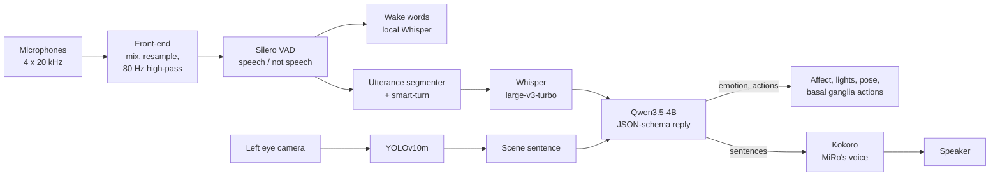
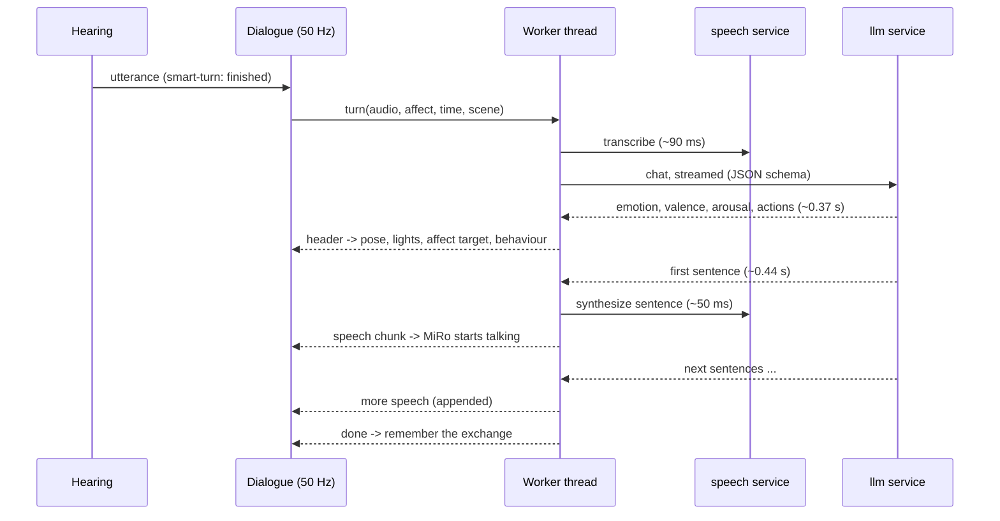
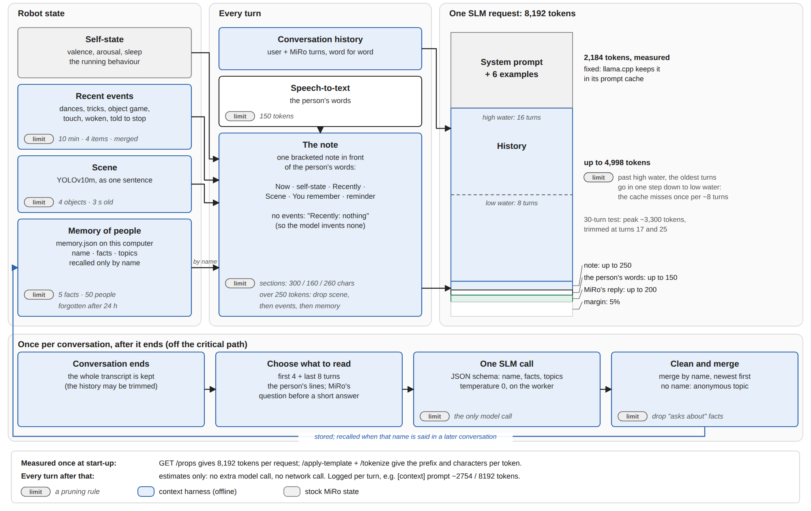

# Hey MiRo: technical documentation

How the local conversation and scene-awareness pipeline is built, which models it uses and why, how each stage
works, and how fast and accurate each stage is (all numbers measured). How to set up and run it (offline or
online, simulator or robot) is in the [README](../README.md). The comparison with the original HRI '25 code is in
[section 19](#19-parity-with-the-hri-25-demo-the-online-pipeline).

**Contents**

1. [Overview](#1-overview)
2. [Where everything runs](#2-where-everything-runs)
3. [Audio front-end: from microphones to clean frames](#3-audio-front-end-from-microphones-to-clean-frames)
4. [Voice activity detection (VAD)](#4-voice-activity-detection-vad)
5. [Wake words](#5-wake-words)
6. [End of turn](#6-end-of-turn)
7. [Speech-to-text](#7-speech-to-text)
8. [The language model](#8-the-language-model)
9. [Text-to-speech](#9-text-to-speech)
10. [Putting a turn together: streaming and latency](#10-putting-a-turn-together-streaming-and-latency)
11. [Scene awareness: YOLO, gestures and scene context](#11-scene-awareness-yolo-gestures-and-scene-context)
12. [How it fits MiRo's brain-inspired architecture](#12-how-it-fits-miros-brain-inspired-architecture)
13. [GPU memory](#13-gpu-memory)
14. [Benchmarks: method, reproduction and caveats](#14-benchmarks-method-reproduction-and-caveats)
15. [Models and licences](#15-models-and-licences)
16. [Prompt and tool-call design](#16-prompt-and-tool-call-design)
17. [Measured results](#17-measured-results)
18. [MiRo's architecture, processes and threads](#18-miros-architecture-processes-and-threads)
19. [Parity with the HRI '25 demo (the online pipeline)](#19-parity-with-the-hri-25-demo-the-online-pipeline)
20. [The context harness for the SLM](#20-the-context-harness-for-the-slm)

---

## 1. Overview

MiRo listens, understands, decides what to say and what to do, and answers in its own voice, all on one PC:



**Design goals**, in order:

1. **Fast:** MiRo should react within about a second of the person stopping. The paper's cloud version waited 3 s of
   silence, then 0.5–5 s for the cloud.
2. **Reliable:** the robot must never be stuck by a bad model output, a slow service, or a noisy room.
3. **Private and offline:** no audio or video leaves the computer, and no API keys or internet are needed after
   setup.
4. **Fit the existing architecture:** the new parts sit in the forebrain and *modulate* MiRo's stock brainstem; they
   don't replace it.

**Measured result** on an RTX 4070 Ti (details in [section 10](#10-putting-a-turn-together-streaming-and-latency)):
from the moment the person's voice stops, MiRo reacts in 0.4–0.5 s to a wake word or "stop", and starts answering
a question in 0.9–1.2 s.

---

## 2. Where everything runs

| Process / container | Language, base | Runs | GPU |
|---|---|---|---|
| **ROS container**, main client (`client_demo.py`) | Python 3.8, ROS Noetic, MiRo MDK | the 50 Hz brain loop, hearing (VAD, segmenter, wake words), dialogue, voice output | no |
| ROS container, `- scene` client | same | YOLO, mediapipe gestures | yes (YOLO) |
| ROS container, `- caml`/`- camr`/`- mics` clients | same | stock MiRo face/ball/AprilTag detection, sound localisation | no |
| **`speech` service** (`docker/local-ai/speech`) | Python 3.12, FastAPI, CUDA | Whisper (speech-to-text), Kokoro (text-to-speech), smart-turn | yes (Whisper, Kokoro) |
| **`llm` service** (`docker/local-ai`, llama.cpp) | C++ | Qwen3.5-4B | yes |

**Why separate containers:** ROS Noetic requires Python 3.8, while current speech and LLM software needs 3.10 or
newer and a recent PyTorch/CUDA. The services talk **OpenAI-compatible HTTP** on `127.0.0.1`, so the robot code uses
the same client for local and cloud (`ai.provider: local | cloud`). Only the base URL changes.

**Why the scene client is a separate process:** YOLO and mediapipe would compete with the 50 Hz brain loop for
Python's global interpreter lock. In their own process they cannot slow the loop down.

**Threads in the main client:** the 50 Hz tick never waits for anything slow:

- the microphone callback only queues frames;
- a hearing thread runs the VAD, the segmenter and the wake-word segmenting;
- a wake-word thread does one transcription at a time;
- two cloud-worker threads run whole conversation turns (speech-to-text → LLM → text-to-speech);
- the sound card's callback mixes speech and music.

Results carry an *episode/turn token*, so an answer that arrives after the conversation has moved on (the person said
"stop", a dance started) is ignored.

---

## 3. Audio front-end: from microphones to clean frames

`core/node_hearing.py`, `core/audio_util.py`

MiRo publishes `sensors/mics` 40 times a second, each message holding 4 channels × 500 samples at 20 kHz:

- channel 0: left ear;
- channel 1: right ear;
- channel 2: centre;
- channel 3: tail.

In the simulator, or with `--ext-mic`, `tools/host_audio_bridge.py` publishes the computer's microphone in exactly
the same format on `host/mics`.

| Step | What it does | Why |
|---|---|---|
| 1. Channel mix | mean of the two ear channels (`hearing.miro_channels: [0, 1]`) | Averaging two microphones keeps the voice (correlated) and averages down uncorrelated noise (about +3 dB SNR). The HRI '25 code *summed* channels in int16 and could overflow. |
| 2. Gain | `hearing.gain` (default 1.0) | for quiet microphones |
| 3. Resample 20 → 16 kHz | stateful polyphase filter (ratio 4/5, Kaiser-windowed sinc; flat to 6.4 kHz, −60 dB at 8 kHz) | VAD and Whisper expect 16 kHz. A proper filter removes aliasing that the HRI '25 `np.interp` decimation let through. |
| 4. **High-pass filter, 80 Hz** | 2nd-order Butterworth biquad (`audio_util.HighPass`, `hearing.highpass_hz: 80`) | Removes wheel/motor rumble, handling noise and mains hum. Voices start around 100 Hz and their intelligibility lies much higher, so nothing useful is lost. |
| 5. Framing | 512-sample frames (32 ms) | the frame size of Silero VAD, Porcupine and Cobra |
| 6. **Self-hearing guard** | the microphones are ignored while MiRo speaks and for 0.3 s after (0.6 s in the simulator, `hearing.self_hearing_guard_s`), and the pre-roll is cleared | Without echo cancellation, MiRo would otherwise hear and answer itself. |
| 7. Touch noise (robot mics only) | per channel: a high peak *and* a high zero-crossing rate means scratching right on an ear or the tail (`forebrain/touch_noise.py`) | drives the "Ouch!" reactions |

**What is deliberately *not* done: spectral noise suppression.** Classic noise suppressors (spectral subtraction,
RNNoise, DeepFilterNet) improve how speech *sounds*, but they add artefacts that often make speech recognition
*worse*. Whisper was trained on millions of hours of real-world, often noisy, audio and is very robust to noise. Our measurements agree:

- **Whisper:** its error rate stays at 4–5% down to 0 dB SNR for white noise and rumble, with or without the
  high-pass ([section 7](#7-speech-to-text)).
- **The 80 Hz high-pass** matters for the parts that measure *energy*. With motor rumble at 5 dB, it turns the energy
  VAD from useless (99% false alarms) into accurate (F1 0.96, 3% false alarms) ([section 4](#4-voice-activity-detection-vad)).
- **The real problem is other voices** (babble): no front-end filter can tell the person talking to MiRo from the
  person behind them. The system copes in four ways:
  1. **wake words**, so MiRo only listens when addressed;
  2. **a close microphone**, `./run.sh --robot --ext-mic` with a directional or USB microphone near the speaker, as at
     the HRI '25 demo;
  3. **Whisper's own no-speech probability**, which rejects segments that are not clear speech;
  4. **conversation timeouts**, so MiRo stops listening when nobody addresses it.

  In the simulator, headphones (or PulseAudio's `module-echo-cancel` on the host, with its source passed as `run.sh --device`) stop MiRo
  hearing its own voice.

---

## 4. Voice activity detection (VAD)

`core/forebrain/wakeword.py` (`SileroVad`, `EnergyVad`), `core/forebrain/segmenter.py`

The VAD gives every 32 ms frame a **probability that it contains speech**. Everything downstream is gated by it:
- the wake-word spotter only transcribes voiced segments;
- the segmenter only records when someone speaks;
- the dialogue nods when speech starts.

**Silero VAD v5** (MIT licence, pip `silero-vad`) is a small neural network, about 2 MB, run as TorchScript on the
CPU in the ROS container. It looks at one 512-sample frame at a time and keeps a short internal state from frame to
frame, so it reacts within a frame or two and holds steady over short gaps between words. Only the model file is
used, loaded directly with `torch.jit.load`, so the package's other dependencies (torchaudio) are not needed.

The fallbacks, chosen with `ai.local.vad`:

- **`energy`:** frame level in dBFS through a soft step at −38 dBFS, smoothed. It needs no model, but it is only
  usable in quiet rooms.
- **`cobra`:** Picovoice Cobra, the paper's VAD, which needs an access key.

**How the probabilities become an utterance** (the segmenter, settings under `hearing.*`):

| Rule | Value | Effect |
|---|---|---|
| speech threshold | `vad_threshold: 0.6` | a frame with p ≥ 0.6 is voiced |
| onset | `onset_frames: 3` (96 ms) | 3 voiced frames in a row start an utterance, so clicks and taps don't |
| pre-roll | `preroll_s: 0.5` | the 0.5 s before the onset is kept, so the first syllable isn't cut |
| re-onset gap | 0.5 s | a new "voiced" event (nod) needs half a second of silence first |
| end | smart-turn, or `end_silence_s` | see [section 6](#6-end-of-turn) |
| nobody speaks | `no_speech_timeout_s: 3.0` | the conversation ends (as in the paper) |
| too long | `max_utterance_s: 20` | the recording is cut and sent anyway |

All timing is counted in **audio samples**, not wall-clock time, so it is correct even when the simulator runs slower
than real time.

**Benchmark:** 10 sentences, 2 voices, with 0.5 s of silence before and 0.8 s after. Each 32 ms frame is scored
against the clean signal (speech = louder than −45 dBFS). F1 = how well speech frames are found; false alarms = the
share of silent frames called speech.

| Noise | SNR | Silero F1 | Silero false alarms | Energy F1 | Energy false alarms |
|---|---|---|---|---|---|
| white | clean | 0.96 | 5% | 0.95 | 0% |
| white | 20 dB | 0.97 | 4% | 0.96 | 0% |
| white | 10 dB | 0.96 | 5% | 0.76 | 47% |
| white | 5 dB | 0.95 | 6% | 0.61 | 98% |
| white | 0 dB | 0.95 | 5% | 0.61 | 99% |
| rumble | 10 dB | 0.96 | 5% | 0.79 | 41% |
| rumble | 5 dB | 0.96 | 5% | 0.61 | 98% |
| rumble | 0 dB | 0.95 | 6% | 0.61 | 99% |
| babble | 20 dB | 0.93 | 10% | 0.96 | 0% |
| babble | 10 dB | 0.82 | 32% | 0.83 | 30% |
| babble | 5 dB | 0.68 | 72% | 0.65 | 83% |
| babble | 0 dB | 0.63 | 93% | 0.62 | 97% |

**The 80 Hz high-pass and the energy VAD** (rumble):

| SNR | without high-pass | with 80 Hz high-pass |
|---|---|---|
| 20 dB | F1 0.96, 0% false | F1 0.95, 0% false |
| 10 dB | F1 0.79, 39% false | F1 0.96, 0% false |
| 5 dB | F1 0.61, 99% false | F1 0.96, 3% false |

**CPU time per frame:** Silero 0.42 ms and energy 0.01 ms. One frame lasts 32 ms, so Silero uses about 1.3% of one
core.

**Reading the results:**

- **Silero is unaffected by hiss and rumble down to 0 dB**, where the energy detector fails completely.
- Silero's constant ~5% "false alarms" are mostly frames right after a word, where it deliberately stays "on" over
  short gaps. That is the behaviour you want for segmenting speech.
- **Other voices are speech, so every VAD fires on them**: babble is handled by the measures in
  [section 3](#3-audio-front-end-from-microphones-to-clean-frames), not by the VAD.

---

## 5. Wake words

`core/forebrain/wakeword.py` (`AsrKeywordSpotter`, `match_wake_phrase`), `core/node_hearing.py`

MiRo responds to **"Hey MiRo"** (start a conversation), **"Dance MiRo"** (dance now) and **"Stop MiRo"** (stop
everything). The paper used Picovoice Porcupine, a dedicated keyword model that needs an account and an access key.
The local pipeline recognises the phrases with **the same Whisper model that does speech-to-text**:

1. **Segment:** the voiced stretches found by the VAD are cut out:
   - onset: 2 voiced frames;
   - plus 0.3 s of pre-roll;
   - ends after 0.35 s of silence, or at 2.5 s at most.
2. **Transcribe:** each segment goes to Whisper with a spelling hint (`"Hey MiRo! Dance MiRo! Stop MiRo!"`), so the
   name comes out as "MiRo". This happens on a background thread, one segment at a time, keeping only the newest
   waiting one.
3. **Reject non-speech:** results where Whisper's own `no_speech_prob` is above 0.6 are dropped.
4. **Match:** the text is matched against the phrases, tolerating how speech recognition writes "MiRo":
   - a lead word (`hey`/`hi`/`hello`/`okay`, `dance`, `stop`) within 3 words of a MiRo-like word;
   - MiRo-like means one of: miro, mirror, milo, meero, mero, nero, … or anything at least 75% similar to "miro";
   - MiRo then the lead word ("MiRo, stop!") also counts.
5. **Mask:** what is listened for depends on what MiRo is doing. While it is talking or dancing, only "Stop MiRo"
   counts. Then speech longer than 1.5 s is not transcribed at all: a stop command is short, and the person's
   sentences are already being transcribed for the conversation. This avoids transcribing everything twice; it
   measured about 20% faster turns on a CPU.
6. A detection goes straight to the hearing node's event queue, and the forebrain starts the conversation, the dance
   or the stop.

**Why this instead of a dedicated keyword model:**

- no account and no per-word training;
- any phrase can be added in code;
- with Whisper already loaded on the GPU, it costs about 90 ms per segment.

The price is that MiRo reacts *after* the phrase (when the segment ends) rather than during it. That is still
0.4–0.5 s in total ([section 10](#10-putting-a-turn-together-streaming-and-latency)). `ai.local.wake_word: porcupine`
switches back to Porcupine if you have a key.

**Benchmark:** 5 wake phrases and 6 similar non-wake sentences ("Hey there", "I like mirrors", "My friend Milo is
here", …). White noise and babble are pooled.

| SNR | Wake phrases recognised | False wakes | Latency (p50) |
|---|---|---|---|
| clean | 5/5 | 0/6 | 89 ms |
| 10 dB | 10/10 | 0/12 | 88 ms |
| 5 dB | 9/10 | 0/12 | 88 ms |
| 0 dB | 9/10 | 0/12 | 88 ms |

---

## 6. End of turn

`docker/local-ai/speech/server.py` (`/v1/turn`), `core/cloud/tts.py` (`TurnDetector`), `core/forebrain/segmenter.py`

Deciding when a person has *finished* is the biggest single delay in a voice conversation. The paper waited a fixed
~3 s of silence. Waiting less makes MiRo interrupt people who pause to think.

The pipeline uses **smart-turn v3.2** (BSD-2, `pipecat-ai/smart-turn-v3`), a model trained for exactly this
question:

- **How it decides:** it listens to *how* the speech ended (intonation, rhythm, trailing words), not just to the
  silence.
- **Model:** the encoder of Whisper-tiny with a small classifier on top, 8 M parameters, int8 ONNX, on the CPU.
- **Input and output:** it takes the last 8 s of the utterance and returns a probability that the turn is complete.

**How it is used:**

| Rule | Value |
|---|---|
| first check | after `turn_min_silence_s: 0.3` s of silence |
| further checks | every 0.3 s of continuing silence |
| "finished" if | probability ≥ `turn_threshold: 0.9` |
| give up waiting | `end_silence_s: 1.2` s of silence (fallback; the paper used ~3 s) |

The check runs on the hearing thread (about 17 ms), never in the 50 Hz loop. If the service doesn't answer, the
segmenter simply falls back to the 1.2 s silence. `ai.local.end_of_turn: silence` restores the paper's behaviour.

**Benchmark** (`tools/bench_pipeline.py --only turn`, plus a threshold sweep):

| Case | Probability "finished" |
|---|---|
| finished sentences (10) | 0.97–0.99, every one |
| sentences cut off at 40/55/70% (32) | spread from 0.01 to 1.0 |

| Threshold | Finished recognised | Cut-off recognised as unfinished |
|---|---|---|
| 0.5 | 10/10 | 10/32 |
| 0.9 (default) | 10/10 | 14/32 |
| 0.95 | 10/10 | 16/32 |

**Interpretation and limits:**

- **The threshold.** Finished speech scores ≥ 0.97, so raising the threshold to 0.9 costs nothing on finished
  sentences. When smart-turn is unsure, MiRo just waits the 1.2 s fallback, so the high threshold only makes MiRo
  more patient.
- **A pessimistic test.** Cutting synthesized sentences in the middle is a crude stand-in for a real person pausing
  mid-thought. The cut audio has the sentence's own intonation up to an abrupt stop, which the model often reads as
  an ending. Real pauses ("I like… um… dancing") carry clearer "not finished" cues.
- **To be measured.** Recordings of real users would give the true numbers; this is the main open evaluation.

---

## 7. Speech-to-text

`docker/local-ai/speech/server.py`, `core/cloud/llm.py` (`OpenAIClients.transcribe`)

**Model: Whisper large-v3-turbo** (OpenAI, MIT), converted to CTranslate2 (`deepdml/faster-whisper-large-v3-turbo-ct2`)
and run by **faster-whisper** with int8 weights and float16 activations (`int8_float16`) on the GPU.

- **The model:** 809 M parameters, the large-v3 encoder with its decoder cut from 32 to 4 layers. It is almost as
  accurate as large-v3 and much faster.
- **Settings:**
  - `beam_size 1`;
  - `language en`;
  - `condition_on_previous_text off`, so a mistake cannot carry into the next segment;
  - no timestamps;
  - no built-in VAD (the audio is already segmented);
  - the spelling hint `"MiRo"` for conversation turns.
- **Guards:** segments Whisper hallucinates from near-silence ("you", "thank you.", "thanks for watching!") are
  treated as nothing heard.

**Latency against utterance length** (GPU):

| Utterance | Latency (p50) | Real-time factor |
|---|---|---|
| 1 s | 86 ms | 0.086 |
| 3 s | 89 ms | 0.030 |
| 6 s | 97 ms | 0.016 |
| 10 s | 108 ms | 0.011 |

That is almost constant, about 90 ms: Whisper always encodes a 30 s window, and the decoder is tiny. On the CPU, the
same 3 s utterance takes about 3.7 s.

**Accuracy in noise:** word error rate over 10 sentences and 2 voices. The 4.0% floor is "colour" vs "color" and
similar spelling, not mistakes:

| Noise | Clean | 20 dB | 10 dB | 5 dB | 0 dB |
|---|---|---|---|---|---|
| white | 4.0% | 4.0% | 4.0% | 4.0% | 5.4% |
| rumble | 4.0% | 4.0% | 4.0% | 4.0% | 4.0% |
| babble | 4.0% | 4.0% | 4.0% | 4.0% | 8.7% (7.2% with the 80 Hz high-pass) |

---

## 8. The language model

`docker/local-ai/compose.yaml` (`llm`), `core/cloud/llm.py`, `core/cloud/tools.py`, `config/persona.md`

**Model: Qwen3.5-4B** (Alibaba Qwen, Apache-2.0), quantised to Q4_K_M GGUF (`unsloth/Qwen3.5-4B-GGUF`, about 2.7 GB)
with its vision projector (`mmproj-F16`, 0.7 GB). It runs in **llama.cpp**'s server with these settings:

| Setting | Value |
|---|---|
| layers on the GPU | all |
| context | 16k tokens, 2 parallel slots (a conversation and an object comment can run together) |
| flash attention | on |
| chat template | the model's own Jinja template |
| reasoning ("thinking") | **off** (`--reasoning-budget 0`, `enable_thinking: false`) |
| prompt cache | **reuse** (`--cache-reuse 256`, `cache_prompt: true`) |

**What one turn sends** (about 1,800 tokens; the order is chosen for the prompt cache):

1. **System prompt:**
   - MiRo's persona (the paper's, `config/persona.md`);
   - the arousal–valence emotion table (the paper's);
   - "what you can do", generated from the action registry;
   - the reply rules, including "mention what your camera sees only when it fits; never claim to see anything you
     were not told about".
2. **Six fixed example exchanges** in the exact reply format. Two of them must **not** trigger an action ("I love
   dancing too", "Your ears are so cute!"), because small models over-trigger tools.
3. **The conversation so far:** up to 10 exchanges, cleared when the conversation ends.
4. **This turn:** `[context]` + the person's words. The context holds:
   - MiRo's current valence and arousal;
   - the time;
   - the scene sentence (see [section 11](#11-scene-awareness-yolo-gestures-and-scene-context)).

   It is put in front of the person's words, not in a second system message. Qwen's template rejects a second system
   message, and the context changes every turn, so it must come *after* everything cacheable.

**Structured output = reliable tool calls.** The reply must match a **JSON Schema** that llama.cpp compiles into a
grammar, so the model *cannot* write anything else:

```json
{"emotion": "happy", "valence": 0.9, "arousal": 0.85,
 "actions": [{"tool": "dance", "song": "Dancing Queen - ABBA"}],
 "reply": "YES! I LOVE ABBA! Let's dance!"}
```

- `emotion` is one of 6; `valence` and `arousal` are numbers.
- `actions` holds at most 2 of: spin, move_ears, impression, sleep, dance(song), tricks, identify_object.
- `song` is one of the bundled songs or `"any"`.
- `reply` is at most 240 characters.

The schema, the prompt's list of actions and the code that executes them are all generated from **one registry**
(`cloud/tools.py`), so they cannot disagree. The fields are generated in this order so the **body can react before
the first word is spoken** (next section). A lenient parser still accepts free text and the paper's "Key: value"
format, so a cloud model without schema support also works.

**Sampling:** Qwen's settings for non-thinking mode, temperature 0.7, top-p 0.8, top-k 20; at most 200 new tokens.

**Benchmark** (`tools/bench_pipeline.py --only llm`):

| Measure | Value |
|---|---|
| prompt size | 1,823 tokens |
| prompt processing without cache | 265 ms (6,900 tokens/s) |
| prompt processing with cache (only the new turn) | **60 ms** |
| generation speed | 128 tokens/s |
| typical reply | 58 tokens |
| time to the emotion + actions ("header") | 0.37 s (p50) |
| time to the first sentence | 0.44 s (p50) |
| whole reply | 0.50 s (p50) |

**Decision quality** (`tools/eval_dialogue.py`, 40 scripted messages: chit-chat, each action, near-misses, garbled
speech recognition):

| Measure | Qwen3.5-4B | Qwen3.5-9B |
|---|---|---|
| valid JSON in schema order | 40/40 | 40/40 |
| right action(s) and song | 38/40 | 38/40 |
| action F1 | 0.95 | 0.96 |
| time to first sentence (p50) | 0.44 s | 0.69 s |
| GPU memory (both AI services) | ~7 GB | 9.5 GB |

The usual misses are borderline cases. For example, "I'm so tired, I want to sleep" made MiRo nap too. Before the
negative examples and the "talking about it is not a request" rule, 4B scored 36/40 with three false triggers. 9B is
not more accurate here, only slower, so 4B is the default (`docker/run_docker.bash --robot-ip IP --offline 9b` on the robot for richer chat).

---

## 9. Text-to-speech

`docker/local-ai/speech/server.py`, `core/cloud/tts.py` (`OpenAISpeech`), `core/node_voice.py`

**Model: Kokoro-82M** (hexgrad, Apache-2.0):

- **Architecture:** an 82 M-parameter text-to-speech model based on the StyleTTS 2 architecture, producing 24 kHz
  audio.
- **Reading words:** text is turned into phonemes by misaki, with espeak-ng for unknown words. Voices are small style
  vectors.

**MiRo's voice.** The paper chose a higher-pitched voice to suit MiRo's size. MiRo uses `af_heart`, raised by a pitch
factor *k* = 1.15:

1. Synthesize at speed / *k*: the speech comes out *k* times longer.
2. Resample by 1 / *k*: playing *k* times faster makes the pitch *k* times higher.

The duration comes back to normal, and no extra model is needed. The Mickey Mouse impression uses `af_sky` at
*k* = 1.45.

**Streaming:** the speech service synthesizes **one sentence at a time** and streams raw 16-bit PCM. The robot appends
each sentence to the speech channel as it arrives (`NodeVoice.say_pcm(append=True)`). MiRo speaks the first sentence
while the LLM is still writing the second.

**Benchmark** (GPU, one request):

| Sentence | Audio length | Synthesis (p50) | Real-time factor |
|---|---|---|---|
| 2 words | 1.43 s | 24 ms | 0.017 |
| 10 words | 3.70 s | 49 ms | 0.013 |
| 21 words | 7.02 s | 50 ms | 0.007 |

---

## 10. Putting a turn together: streaming and latency

`core/forebrain/dialogue.py` (`TurnRunner`, `DialogueMachine`), `core/cloud/llm.py` (`ReplyStream`)

A conversation turn is **one job on a worker thread** that reports progress on a queue while it runs:



- **`ReplyStream`** parses the JSON *while it streams*. When the `actions` list closes, it knows the emotion and the
  actions; it then decodes the `reply` string sentence by sentence (sentences of at least 20 characters). If the
  model ignored the format, the full text is parsed at the end instead.
- **Speaking starts at the first sentence**, after the "hmm" clip if one is playing. The waiting tune only plays
  while there is nothing to say yet.
- **A dance hands over at once:** the reply is not spoken, and the dance intro clip plays instead, as in the paper.

**End-to-end latency** in Gazebo (`tools/fake_user.py`), measured **from the moment the person's voice stops** until
MiRo visibly reacts. This includes deciding that they have finished:

| The person says | MiRo | After (GPU) | After (CPU only) |
|---|---|---|---|
| "Hey MiRo!" | greets | 0.38 s | 5.2 s |
| "Hi! What is your favourite band?" | starts answering | 0.91 s | 14.9 s |
| "Can you spin around for me?" | starts answering and spins | 1.20 s | 13.7 s |
| "Can you dance to Dancing Queen?" | starts dancing | 1.23 s | 14.3 s |
| "Stop MiRo!" | stops, says goodbye | 0.46 s | 5.1 s |

**Where the ~1 s goes** (GPU, typical question; estimated from the stage benchmarks above):

| Stage | Time |
|---|---|
| end of turn (≥ 0.3 s of silence + smart-turn check) | ~0.32 s |
| speech-to-text | ~0.09 s |
| LLM to the first sentence (cached prompt) | ~0.44 s |
| text-to-speech of that sentence | ~0.05 s |
| audio output buffer and state changes | ~0.1 s |

The paper's cloud pipeline took about 3 s of fixed silence, then 0.5–5 s (up to 20 s on poor Wi-Fi).

---

## 11. Scene awareness: YOLO, gestures and scene context

`core/node_scene.py` (the `- scene` client), `core/forebrain/scene_context.py`, `core/node_forebrain.py`
(`compute_scene_mode`), `core/action/action_identify.py`, `core/action/action_tricks.py`

### 11.1 The scene client

A separate process (`client_demo.py - scene`) watches MiRo's **left eye camera** (`sensors/caml/compressed`,
640 × 360 JPEG). The main client tells it what to look for on `core/scene/mode`, re-sent every second:

| Mode | When | Models | Publishes |
|---|---|---|---|
| `off` | nothing needs vision | none; the camera is not even subscribed (saves Wi-Fi bandwidth) | — |
| `objects` | the object game ("guess what I'm holding") | YOLO, the 13 game classes (`identify.classes`) | `core/scene/objects` |
| `gestures` | tricks | mediapipe GestureRecognizer | `core/scene/gesture` |
| **`context`** | **any conversation** (`features.scene_context`) | YOLO, all 80 COCO classes (`scene.context_classes: []`) | `core/scene/objects` |

If main stops sending the mode for 3 s, the client falls back to `off`. Frames older than 1 s are skipped. The models
are loaded on first use, and if one fails, the other keeps working.

**YOLOv10m** (Ultralytics, trained on COCO's 80 everyday classes: people, cups, phones, books, dogs, chairs, …):

- **Settings:** confidence ≥ 0.4, run at `scene.rate_hz` (5 Hz on the robot, 1 Hz in the simulator so Gazebo keeps
  its GPU time).
- **Confirmation:** an object counts as *confirmed* when it was seen in **4 of the last 10 frames**
  (`identify.confirm`, as in HRI '25), which filters out single-frame mistakes.
- **No non-maximum suppression:** YOLOv10 is "NMS-free", so it outputs one box per object without that post-processing
  step, which is part of why it is fast.

**Gestures:** mediapipe's GestureRecognizer (hand landmarks + classifier, CPU):

- **Smoothing:** a gesture must be seen in 3 of the last 5 frames.
- **Ignored:** Closed_Fist and both thumbs, as in HRI '25.
- **Tricks:** Open_Palm → greet and nod, Pointing_Up → spin, Victory → ear wiggle, ILoveYou → party lights.

**Benchmark** (640 × 360 frames, all 80 classes):

| Model | Device | Per frame (p50) | Frames/s |
|---|---|---|---|
| YOLOv10m (used) | GPU | 3.7 ms | 273 |
| YOLOv10n | GPU | 2.9 ms | 340 |
| YOLOv10m | CPU | 63 ms | 16 |
| YOLOv10n | CPU | 15 ms | 66 |
| mediapipe gestures | CPU | 9.3 ms | ~100 |

The very first YOLO call takes ~0.5 s (CUDA start-up). At 5 Hz, YOLOv10m uses under 2% of the GPU's time. On a
computer without a GPU, `scene.yolo_weights: yolov10n.pt` keeps the scene client light.

### 11.2 Scene context: YOLO as text, not image tokens

While MiRo is in a conversation, the scene client runs in `context` mode, and **what MiRo sees is given to the LLM
as one short sentence of text**. `forebrain/scene_context.py` builds it from the latest objects message:

```
Your camera sees: a person in front of you, a cup on your left.
Your camera sees: two people, a tie in front of you.
```

How the sentence is built:

- only **confirmed** objects (4 of 10 frames), at most 4, the most confident first;
- **position** from the box centre: left third → "on your left", middle → "in front of you", right third → "on your
  right";
- **"right in front of you"** when the box covers more than a quarter of the image, meaning the object is close;
- **counts** for repeated objects ("two people"); then no position is given, since the objects may be in different
  places;
- nothing if the newest message is older than 3 s.

The sentence goes into the turn's `[context]`. The system prompt tells MiRo to use it only when it fits, and never to
claim to see anything it was not told about.

**Why text and not the camera image?** Qwen3.5 *is* a vision-language model and could look at the frame itself, but:

| What the LLM gets per turn | Extra prompt tokens | Time to process the prompt |
|---|---|---|
| the 640 × 360 camera frame (vision encoder + image tokens) | 222 | 135 ms |
| YOLO's sentence ("a person in front of you, a cup on your left") | 19 | 51 ms |

(Measured with `tools/bench_pipeline.py --only vision`; YOLO itself adds 3.7 ms, in another process.)

- **Faster every turn:** the image costs about 12× more tokens and ~85 ms more on *every* answer. The frame changes
  every turn, so it can never be served from the prompt cache.
- **Steadier and more trustworthy:** YOLO's output is confirmed over several frames, so a passing blur doesn't become
  "I see a dog!". The model is told only things that were actually detected, which limits hallucination.
- **Cheaper in memory and bandwidth:** the camera is already decoded for YOLO, and the conversation context stays
  small (the 16k context holds a long conversation).
- **Grounded in the architecture:** like the stock MiRo, perception is done by dedicated "midbrain" detectors, and the
  forebrain reasons over their *results*.

**The trade-off:** MiRo only knows the 80 COCO classes and where they are. It cannot read text, name colours, or say
what a drawing shows. For such questions, sending a single frame to the vision-language model would be a natural
extension; it is not implemented.

**Example** (real photos through the real code; `scene.device` GPU):

| Camera sees (YOLO) | Person asks | MiRo answers |
|---|---|---|
| "two people, a tie in front of you" | "What can you see right now?" | "Ah, I see two people and a tie! What do you think of that?" |
| "a person on your left" | "What can you see right now?" | "I see a person on my left! Is that you, my friend?" |
| "a person on your left" | "Do you like dogs?" | "Hmmm, I like many animals! But I'm jealous of birds because they fly. What about dogs?" (the scene is not dragged in) |

In the Gazebo arena the camera mostly sees walls and a ball. The scene sentence is then empty, and MiRo says
nothing about the scene.

---

## 12. How it fits MiRo's brain-inspired architecture

The stock MiRo controller (Mitchinson & Prescott, 2016) is layered like a vertebrate brain:

- **spinal cord:** reflexes;
- **brainstem:** affect, expression and spatial attention;
- **basal ganglia:** action selection.

Everything above sits in the **forebrain** and *modulates* these layers instead of commanding the motors directly:

| Forebrain output | How it reaches the lower layers |
|---|---|
| reply emotion, valence, arousal | `affect.set_forebrain_target()` pulls MiRo's affect toward them; lights and pose follow through the stock expression system |
| actions (dance, tricks, identify) | a request on the forebrain's task board; the action wins in the **basal ganglia** with priority 0.84 (0.89 while running), above orient/approach (≤ 0.8) and below the protective actions (halt and cliff avoidance, 0.9–1.0) |
| spin, ears, impression | flourishes inside the conversation action, borrowing the ears and lights for a few ticks |
| what to listen for | the wake-word mask (only "Stop MiRo" while busy) |
| what to look for | the scene mode (`off`, `objects`, `gestures`, `context`) |
| MiRo speaking | counted as vocalising, so MiRo's own sound doesn't drive its auditory attention |

So MiRo keeps all of its animal-like behaviour (exploring, orienting to faces and sounds, reacting to touch, cliff
reflexes), and language is one more source of goals.

---

## 13. GPU memory

| Configuration | GPU memory used (RTX 4070 Ti, 12 GB, desktop included) |
|---|---|
| AI services only (Qwen3.5-4B + Whisper + Kokoro) | ~7.0 GB |
| + Gazebo, camera clients, YOLOv10m (full simulator demo) | 7.9 GB |
| AI services with Qwen3.5-9B (robot, no Gazebo) | 9.5 GB |

---

## 14. Benchmarks: method, reproduction and caveats

**Machine:** RTX 4070 Ti (12 GB), 24-thread desktop CPU, Ubuntu 24.04, NVIDIA driver 580, Docker 29. The models are
the pinned revisions in `docker/local-ai/models.env`.

**Reproduce** (AI services running; inside the MiRo container started with the GPU):

```bash
python3 tools/bench_pipeline.py --images <folder of photos> --weights yolov10m.pt,yolov10n.pt --json bench.json
python3 tools/eval_dialogue.py --json eval.json
python3 tools/fake_user.py --log run.json          # with ./run.sh --sim --no-bridge running
```

**How the audio tests are made:**

- **Speech** is synthesized by the speech service (Kokoro voices `am_michael` and `bf_emma`, not MiRo's), so the
  correct text is known.
- **Noise** is added at a known signal-to-noise ratio:
  - *white*: broadband hiss;
  - *rumble*: tones at 32/55/90/130 Hz plus low-passed noise, like motors and wheels;
  - *babble*: three other synthesized voices talking over each other.
- **VAD ground truth:** a frame of the clean signal louder than −45 dBFS counts as speech.

**Caveats:**

- **Synthetic speech and noise.** Synthesized speech is clean, clearly articulated and has no room echo, and
  synthetic noise is simpler than a real exhibition hall. Absolute accuracy with real people in real rooms will be
  lower; the comparisons (Silero vs energy, high-pass on/off, CPU vs GPU, 4B vs 9B) are what these numbers are good
  for.
- **smart-turn.** Its "unfinished" test (sentences cut mid-way) is a crude stand-in for real pauses (section 6).
- **Small samples.** 10 sentences, 40 dialogue cases and two photos are small. Treat differences of one or two cases
  as noise.
- **What is still missing:** an evaluation with recordings of real users, on the robot, in a noisy room.

---

## 15. Models and licences

All the models are ungated on Hugging Face (no login, no licence click-through) and pinned to a revision in
`docker/local-ai/models.env`.

| Job | Model | Licence | Size | Runs on |
|---|---|---|---|---|
| LLM (default) | `unsloth/Qwen3.5-4B-GGUF` Q4_K_M + mmproj (vision) | Apache-2.0 | 3.4 GB | GPU |
| LLM (quality profile, `--9b`) | `unsloth/Qwen3.5-9B-GGUF` Q4_K_M + mmproj | Apache-2.0 | 6.6 GB | GPU |
| Speech-to-text | `deepdml/faster-whisper-large-v3-turbo-ct2` (int8_float16) | MIT | 1.6 GB | GPU |
| Text-to-speech | `hexgrad/Kokoro-82M` | Apache-2.0 | 0.3 GB | GPU |
| End of turn | `pipecat-ai/smart-turn-v3` v3.2 (int8 ONNX) | BSD-2-Clause | 9 MB | CPU |
| Voice activity | Silero VAD v5 (pip `silero-vad`, model file only) | MIT | 2 MB | CPU (robot container) |

**Why 4B by default:** measured on the RTX 4070 Ti with `tools/eval_dialogue.py`, 9B picked the right action no more
often than 4B (38/40 each, F1 0.96 against 0.95). It was slower, though: 0.69 s against 0.44 s to the first sentence.
It also needs 9.5 GB instead of 7 GB with the speech models loaded, which is too much alongside Gazebo. It fits on the
robot (no Gazebo on the GPU): `docker/run_docker.bash --robot-ip IP --offline 9b`.

**MiRo's voice:** the paper chose a higher-pitched voice to suit MiRo's size. Kokoro's `af_heart` is synthesized
slower and resampled faster (`ai.local.pitch: 1.15`), which raises the pitch without changing the speed. The Mickey
Mouse impression uses `af_sky` at pitch 1.45.

### What is faster than the HRI '25 pipeline, and why

From the moment the user stops talking until MiRo starts to answer:

| Step | HRI '25 (cloud) | Local |
|---|---|---|
| Decide the user has finished | fixed ~3 s of silence | smart-turn: from 0.3 s of silence (at most `ai.local.end_silence_s` = 1.2 s) |
| Speech-to-text | upload + Whisper API | Whisper turbo on the GPU |
| LLM | the whole reply, then parse | streamed; the body reacts after ~25 tokens (emotion and actions come first) |
| Text-to-speech | the whole reply, then play | the first sentence plays while the rest is generated |

Measured numbers are in [section 17](#17-measured-results).

### Offline settings (`config/heymiro.yaml`, `ai:`)

| Key | Default | Meaning |
|---|---|---|
| `ai.provider` | `local` | `local` or `cloud` |
| `ai.local.llm_url`, `speech_url` | `http://127.0.0.1:8080/v1`, `:8090/v1` | where the services are (`HEYMIRO_LLM_BASE_URL` / `HEYMIRO_STT_BASE_URL` override them) |
| `ai.local.stream` | true | speak the first sentence while the rest is generated |
| `ai.local.structured_output` | true | send the JSON Schema (grammar-constrained replies) |
| `ai.local.wake_word` | `asr` | `asr` (local Whisper) or `porcupine` (needs a Picovoice key) |
| `ai.local.vad` | `silero` | `silero`, `energy` or `cobra` |
| `ai.local.end_of_turn` | `smart_turn` | `smart_turn` or `silence` (fixed `hearing.end_silence_s`, the paper's behaviour) |
| `ai.local.turn_threshold`, `turn_min_silence_s`, `end_silence_s` | 0.9, 0.3, 1.2 | smart-turn decision threshold, first check, longest wait |
| `ai.local.voice`, `pitch`, `speed` | `af_heart`, 1.15, 1.05 | MiRo's Kokoro voice |
| `ai.local.impression_voice`, `impression_pitch` | `af_sky`, 1.45 | the Mickey Mouse impression |
| `ai.local.settings` | `llm.model: heymiro`, … | replaces the cloud `llm` / `stt` settings when local |

---

## 16. Prompt and tool-call design

The LLM's job each turn is to say something *and* to decide what MiRo's body should do. Small local models get this
wrong more easily than GPT-4o, so the design takes the guesswork away:

1. **One registry of actions** (`core/cloud/tools.py`): spin, move_ears, impression, sleep, dance(song), tricks
   and identify_object. Each has a description, *when to use it* and *when not to*. The registry generates:
   - the reply's JSON Schema;
   - the "What you can do" section of the system prompt;
   - the mapping onto the command flags the rest of the code already understands.

   The prompt, the schema and the code cannot drift apart.
2. **Grammar-constrained output.** The schema is sent as `response_format: json_schema`, and llama.cpp compiles it
   into a grammar, so the model *cannot* produce anything else:
   - one of the six emotions;
   - valence and arousal in [0, 1];
   - at most two known actions;
   - for dance, a song from `config/songs.yaml` or `"any"`, so it cannot pick a song that does not exist;
   - a reply of at most 240 characters.
3. **Field order chosen for latency.** The order is `emotion, valence, arousal, actions, reply`, so the pose, the
   lights and the behaviour are decided before the first spoken word is generated.
4. **Few-shot examples, including negative ones.** Six fixed example exchanges show the format. They include
   "I love dancing too" and "Your ears are so cute!", which must **not** trigger an action. Small models over-trigger
   tools, and these examples fixed most of that (see Results).
5. **Prompt-cache-friendly layout.** The order is: system prompt → examples → history → `[context]` + user message.
   Everything up to the history is identical every turn, so llama.cpp reuses its cache and only processes the new
   message. The per-turn context (valence, arousal, time) goes *in front of the user's words* rather than in a second
   system message. Qwen's chat template rejects a second system message, and putting the context there would also
   break the cache.
6. **Spoken-language rules.** The reply must be one or two short sentences, with no emoji, markdown or stage
   directions. The model is also told that the words come from speech recognition and can be wrong, so it asks
   again instead of guessing.
7. **Sampling and server settings.** Qwen's non-thinking settings: temperature 0.7, top_p 0.8, top_k 20.
   "Thinking" is off on the server (`--reasoning-budget 0`), since a pet robot should answer immediately.

The same schema and prompt also work with GPT-4o, and the reply parser still accepts the HRI "Key: value" format and
free text, so the cloud provider benefits too.

---

## 17. Measured results

**Run 1: CPU only** (October 2026, 24-thread desktop CPU; Docker's GPU runtime not yet configured on the test
machine). Everything ran locally, but without the GPU.

`tools/eval_dialogue.py`, Qwen3.5-4B Q4_K_M, 40 cases:

| Metric | Result |
|---|---|
| valid JSON | 40/40 |
| keys in schema order | 40/40 |
| actions exactly right (incl. the song) | 39/40 |
| precision / recall / F1 | 0.96 / 1.00 / 0.98 |
| reply length | mean 11.7 words, max 18; no emoji or stage directions |
| latency (CPU) | header p50 2.7 s, first sentence p50 3.3 s |

The one miss was "I'm so tired, I want to sleep": MiRo decided to nap too. Before the negative few-shot example and
the "talking about it is not a request" rule, the score was 36/40 (F1 0.91), with three false triggers.

`tools/fake_user.py` in Gazebo (wake → question → spin → "dance to Dancing Queen" → "Stop MiRo"):

- Every step was understood and carried out, in three runs.
- End of the user's words → MiRo's answer took about 18 s on the CPU at first, and about 14 s after two fixes:
  - the busy wake-word check no longer transcribes whole sentences a second time;
  - the LLM prompt cache is warmed at start-up.

  The rest is Whisper (about 3.7 s) and LLM processing on a CPU that Gazebo also uses.
- Wake word: about 5 s on the CPU.
- The speech service alone (CPU): Kokoro synthesizes a sentence in 0.35–0.45 s, and smart-turn decides in about
  17 ms.

**Run 2: GPU (RTX 4070 Ti, 12 GB).** Same machine and models.

| Step | CPU | GPU |
|---|---|---|
| Whisper large-v3-turbo, 3 s utterance | 3.7 s | 0.10 s |
| Kokoro, one sentence | 0.4 s | 0.06 s |
| LLM: time to header (emotion + actions) | 2.7 s | 0.37 s (p50) |
| LLM: time to the first sentence | 3.3 s | 0.44 s (p50) |
| LLM prompt-cache warm-up at start | 8–12 s | 0.5 s |

`tools/eval_dialogue.py` on the GPU:

- **Format:** 40/40 valid JSON, all in schema order.
- **Actions:** 38/40 exact, F1 0.95.
- **The two misses:** "I'm so tired, I want to sleep" → MiRo naps too; "What is this object?" → no object game.
  Results vary by one or two cases between runs at temperature 0.7.

`tools/fake_user.py` in Gazebo, measured from the moment the user's voice stops (this includes smart-turn deciding
that they have finished):

| User says | MiRo reacts | after |
|---|---|---|
| "Hey MiRo!" | greets | 0.38 s |
| "Hi! What is your favourite band?" | starts answering | 0.91 s |
| "Can you spin around for me?" | starts answering (and spins) | 1.20 s |
| "Can you dance to Dancing Queen?" | starts dancing | 1.23 s |
| "Stop MiRo!" | stops and says goodbye | 0.46 s |

The HRI '25 demo waited a fixed 3 s of silence before it started transcribing, and the paper reports 0.5–5 s after
that.

**GPU memory** with Gazebo, the camera clients, YOLOv10m, Qwen3.5-4B + mmproj, Whisper and Kokoro all running:
7.9 GB of 12 GB (the desktop included).

**Docker and the GPU:** Docker 25+ exposes NVIDIA GPUs through CDI (`docker info` lists `nvidia.com/gpu=all`), and no
`nvidia` runtime entry is needed. `up.bash` and `run_docker.bash` accept either. Without a usable GPU, `up.bash`
starts the same services on the CPU (`compose.cpu.yaml`) with a warning.

The numbers above were measured with the two-copy layout the code had in October 2026; the code paths are unchanged
in `src/heymiro`. A re-run in November 2026 (RTX 4070 Ti, `ai.provider: local`, headless Gazebo) gave 40/40 valid
JSON, F1 0.98 and 0.46 s to the first sentence (p50) in `tools/eval_dialogue.py`, and every `tools/fake_user.py`
step understood, with MiRo reacting 0.5–1.8 s after the user's voice stopped.

---

## 18. MiRo's architecture, processes and threads

### Background: MiRo's layered, brain-based control

MiRo-e's control system follows Mitchinson & Prescott (2016), *MIRO: A robot "mammal" with a biomimetic
brain-based control system*. Its control loops are **layered** like the vertebrate nervous system. Lower layers
keep working on their own, and higher layers **modulate** them (suppress, potentiate, prime) rather than replace
them.

- **Spinal cord (P1)**
  - Signal conditioning.
  - Reflexes: the *cliff reflex* stops the wheels at an edge; the *freeze reflex* stops all movement when MiRo is
    picked up.
- **Brainstem (P2)**
  - **Affect** as a circumplex of *valence* and *arousal*, driven by touch, sound, light and the time of day,
    with a sleep oscillator.
  - **Social pattern generators** (SPG): lights, ears, tail and eyelids express that affect.
  - A **spatial behaviour system** (superior colliculus) builds a salience map from vision and from sound
    localised with a Jeffress model. It generates plans: *orient*, *approach*, *flee*, *avert*.
  - The **basal ganglia** (BG) pick one plan at a time, with persistence and pre-emption, for the **motor
    pattern generator** (MPG).
- **Forebrain (P3)**: higher systems that *modulate* the lower ones.
- **P4**: off-board processing. It is slower but more capable.

The stock MDK demo (`client_demo.py`) implements P1–P2 as a set of nodes (`node_lower`, `node_affect`,
`node_express`, `node_spatial`, `node_detect_*`, `node_action` + `action/basal_ganglia.py`, `node_loop`) spread
over several processes: the main client plus the `caml`, `camr` and `mics` clients.

### What Hey MiRo adds (HRI '25)

The HRI '25 paper (Fig. 2) adds **forebrain** components. In this code base they are new nodes and actions that
plug into the stock architecture without replacing it, plus **P4** clients for cloud services.

| Layer | Stock modules (unchanged unless noted) | Hey MiRo additions |
|---|---|---|
| Spinal cord (P1) | `node_lower` (touch, jerk, sound level); cliff and freeze reflex flags | `ActionAvert` (cliff aversion) restored |
| Brainstem: affect | `node_affect` | `set_forebrain_target()` lets LLM replies, dancing and touch pull valence/arousal; `wake()` and `request_sleep()`; fixed `mood.arousal` clipping |
| Brainstem: SPG | `node_express` | `override()` / `release()`: forebrain behaviours borrow lights, ears, tail or eyelids for a few ticks |
| Brainstem: spatial | `node_spatial`, `node_detect_*`, Jeffress engine | the sound-localisation input topic is configurable (`host/mics` in sim) |
| Brainstem: BG | `node_action`, `basal_ganglia.py` | four forebrain actions in a priority band of their own (below) |
| Brainstem: MPG / loop | `node_loop`, kc | speech counts as vocalising for reafference gating |
| **Forebrain: linguistic** | — | `node_hearing` (wake words, VAD, utterance capture, touch-noise), `node_dialogue` + `forebrain/dialogue.py` (conversation state machine), `node_voice` (clips, speech, music) |
| **Forebrain: scene awareness** | — | `node_scene` in its own `- scene` client (YOLO objects, mediapipe gestures) |
| **Forebrain: integration** | — | `node_forebrain` (events → intentions, top-down modulation), `node_cues` (attentional eyelid cues) |
| **Forebrain: behaviours** | — | `action_converse`, `action_dance` (+ `choreography/`), `action_tricks`, `action_identify` |
| **Off-board (P4)** | — | `cloud/llm.py` (Whisper and GPT through any OpenAI-compatible route), `cloud/tts.py` (ElevenLabs), `cloud/music.py` (song library, optional Spotify), `cloud/worker.py` |

`core/heymiro_config.py` holds the settings, secrets and API routes.

#### Processes

| Client | Command | Does |
|---|---|---|
| main | `client_demo.py -` | affect, express, action selection, forebrain nodes, kinematics; 50 Hz, driven by `sensors/package` |
| caml / camr | `client_demo.py - caml` / `- camr` | stock face, motion and AprilTag detection per camera |
| mics | `client_demo.py - mics` | stock sound localisation (from `hearing.salience_topic`) |
| scene | `client_demo.py - scene` | YOLO + mediapipe; subscribes to the camera only while main asks for it on `core/scene/mode` |
| bridge (optional) | `tools/host_audio_bridge.py` | host microphone → `host/mics` (sim, or `--ext-mic` on the robot) |

#### Threads in the main client

The 50 Hz tick runs in the `sensors/package` callback. It must stay fast: no network calls, no model inference,
no waiting.

| Thread | Work |
|---|---|
| 50 Hz tick | All nodes' `tick()` and the actions. It only polls futures and queues. |
| Mic callback | Puts frames on NodeHearing's queue. |
| NodeHearing worker | Resampling 20 → 16 kHz, Porcupine, Cobra, the utterance segmenter, the touch-noise detector. |
| CloudWorker (2 threads) | STT → LLM → parse → TTS for one turn; song lookup and mp3 decoding. |
| Audio output stream (sounddevice) | Mixes the speech and music channels. |

Results carry an *episode id*, so an answer that arrives after the conversation has moved on is discarded.

### The conversation (HRI paper §II-B-1)

```
"Hey MiRo" (Porcupine)
   │  node_forebrain → affect.wake(), dialogue.on_wake()
   ▼
FACING     turn until an AprilTag is in view (or to the last sound, or skip)
GREETING   greeting clip ("What's up?") + lean in, look up, ears perk
LISTENING  segmenter armed: speech onset (Cobra VAD) → nod; ends after ~3 s of silence
THINKING   "Hmm" clip + loading tune; worker: wav → Whisper → GPT-4o (persona + current
           valence/arousal + time, JSON reply) → ElevenLabs
RESPONDING speak; emotion pose + LED colour; flourishes (spin, ear flapping, impression voice);
           affect pulled to the reply's valence/arousal
   └──► LISTENING …  no speech for ~3 s → GOODBYE clip → IDLE (MiRo resumes exploring)
```

The LLM is asked for a JSON object:

```json
{"valence": 0.8, "arousal": 0.7, "emotion": "happy", "reply": "...",
 "commands": {"spin": false, "sleep": false, "move_ears": false, "impression": false,
              "dance": false, "song": null, "tricks": false, "identify_object": false}}
```

A lenient parser also accepts the older HRI "Key: value" line format and plain text, so a model that ignores the
format still works.

- **Behaviour commands.** `dance`, `tricks` and `identify_object` hand over to a separate behaviour. The dialogue
  is suspended and then resumes ("that was fun — want to keep talking?").
- **`sleep`.** The affect node's sleep pressure is raised.
- **Stop.** "Stop MiRo" ends whatever is happening.

### Action selection

`basal_ganglia.py` is unchanged: winner-take-all, +0.05 hysteresis for the running action, a little noise, and
priorities clipped to [0, 1]. The forebrain actions use their own band:

| Behaviour | Priority |
|---|---|
| mull (idle) | 0.1 |
| orient / approach / flee | up to 0.8 (`priority_attend`) |
| **converse / dance / tricks / identify** | **0.84 × surface confidence** (0.89 while running) |
| halt (stall), avert (cliff), mull while touched | 0.9 – 1.0 |

What this ordering gives:

- A forebrain request pre-empts orienting and approaching.
- A running forebrain behaviour is never interrupted by them.
- Cliff aversion and halting still win at any time.
- Nothing reaches the 1.0 clip, where actions would tie.

The HRI version used 2 / 1.5 / 1.2. Those were all clipped to 1.0 and flapped against each other.

Only one forebrain behaviour is wanted at a time. `node_forebrain` holds a single task slot, and the dialogue
suspends while a task (dance, tricks, identify) runs.

### Dancing (HRI paper §II-B-3)

1. "Dance MiRo", or a dance request in conversation ("dance to Dancing Queen"), resolves a song from
   `config/songs.yaml` (fuzzy match on title, artist and aliases; a random song otherwise).
2. The song is decoded on the worker thread.
3. `action_dance` plays an intro clip and the music, and steps a `choreography.DanceController` with the
   **music playback position**. Head moves, wheel spins, ears and lights follow the beat (period 60/bpm).
4. The dance stops when the song ends, after `dance.max_duration_s`, on "Stop MiRo", or when a protective
   behaviour pre-empts it.
5. While it runs, valence rises and arousal follows the tempo.

Spotify's audio-analysis and preview endpoints are no longer available to new apps. The tempo of each bundled
song is therefore measured offline with `tools/estimate_bpm.py` and stored in `songs.yaml`. A Spotify lookup can
be switched on with `features.spotify`.

### Scene awareness (HRI paper §II-B-2)

The `- scene` client runs only while main requests it on `core/scene/mode`:

- **Gestures** (mediapipe), during *tricks* (or always, if `features.spontaneous_gestures`):
  - Open_Palm → greeting and nod
  - Pointing_Up → spin
  - Victory → ear wiggle
  - ILoveYou → party lights
- **Objects** (YOLO, 13 COCO classes), during the *identify* game: an object confirmed in 4 of 10 frames gets an
  LLM one-liner.

Touch on MiRo's body and head drives affect through the stock pathways. Scratching the ears or tail is detected
from the noise it makes in MiRo's own microphones; it plays an "Ouch!" clip and pushes valence down. Stroking
plays pleased noises.

---

## 19. Parity with the HRI '25 demo (the online pipeline)

This compares three things for every behaviour:

- **the paper**: Htet et al., *Hey Miro!*, HRI '25, §II-B and §III;
- **the original demo code**: the `New_Miro_Demo` folder inside the Docker image `aung9htet/ros_miro:public`
  (2025-03-31, last commit `523170c`);
- **this repository**: `src/heymiro`, with `ai.provider: cloud` (the HRI services)
  and `ai.provider: local` (the offline pipeline).

It was checked in October 2026 by:

- reading the original code;
- running the unit tests (291 passed in each of the two copies the code had then);
- running the environment smoke test;
- running both providers end to end in the Gazebo simulator.

"Intended change" means the refactor does something on purpose that differs from the original. **Regression**
means something the original did that the refactor broke. One regression was found, and it is fixed.

### Regression found and fixed

| What | Effect | Fix |
|---|---|---|
| `client_demo.py` read `sensors/package.flags` as an int. It is a `std_msgs/UInt32` message. | `TypeError` on **every** 50 Hz tick, robot and sim: the whole brain (stock behaviours *and* the forebrain) never ran. The unit tests did not catch it because they do not build a real ROS message. | `msg.flags.data` (commit `6863112`). With the fix, orient/approach/flee/mull and every forebrain command were checked in Gazebo. |

### Behaviour by behaviour

| Behaviour (paper) | Original code | This repository | Status |
|---|---|---|---|
| **"Hey MiRo" wake word** (§II-B-1, Porcupine) | `node_detect_word`: Porcupine with `Hey-Miro_en_linux_v3_0_0.ppn`. Only "Hey MiRo" was active. | cloud: Porcupine with the same `.ppn` files, plus "Dance MiRo" and "Stop MiRo". local: the phrase is recognised by local Whisper (no key needed). | Same; extended |
| **Attention on wake**: lean in, head tilt, nod (§II-B-1) | `action_llm`: `look_up` → greeting clip → `lean_forward`; random nods while listening | `action_converse`: FACING (AprilTag) → GREETING (same clips) → lean in, look up, ears perk; a nod on each speech onset | Same |
| **Record until ~3 s of silence** (Cobra VAD) | `silence_count` of 32 ms blocks; Cobra re-run on the whole recording; ends at 80 blocks ≈ 2.6 s | cloud: Cobra per 32 ms frame, `end_silence_s: 3.0`. local: Silero VAD, then smart-turn ends the turn once the speaker has finished (0.3–1.2 s) | Same (cloud); faster (local) |
| **Whisper transcription** | `openai.Audio.transcribe("whisper-1")`, blocking inside the 50 Hz tick | cloud: whisper-1 on a worker thread. local: Whisper large-v3-turbo | Same; no longer blocks the robot |
| **GPT-4o with persona, emotion state, time** | One long prompt: valence/arousal plus time as extra system messages each turn. Fixed "Key: value" reply lines, parsed by line number. | cloud: GPT-4o with the same persona (`config/persona.md`), the same emotion table and the same flags, in JSON. The old line format is still parsed. local: Qwen3.5 with a JSON-schema-constrained reply | Same content; robust parser |
| **ElevenLabs voice** (higher pitched) | voice `vy5FHcwTzRxpcxreOntL`, impression `dfZGXKiIzjizWtJ0NgPy` | cloud: `tts.voice_id: 0m2tDjDewtOfXrhxqgrJ`, `impression_voice_id: dfZGXKiIzjizWtJ0NgPy`. local: Kokoro `af_heart` with pitch ×1.15 | **Check:** MiRo's voice id differs from the March 2025 image. If the HRI demo used `vy5F…`, set it in `config/heymiro.yaml`. |
| **Pre-recorded clips** (hums, cries, greetings, goodbyes) | `miro_clips_HD/*` | the same files in `assets/clips/`, listed in `config/clips.yaml` | Same |
| **"Hmm" + music while waiting** (§III) | `hmm_thinking`, then the `loading` tune | the same clips. local: only played when the reply is not ready yet | Same |
| **Repeat until no voice for 3 s**, then explore | `silence_count >= 80` with no voice → goodbye clip, history reset | `no_speech_timeout_s: 3.0` → GOODBYE clip → IDLE; memory cleared | Same |
| **Spin** | spins at 0.4 rad/s while speaking | spins at 0.4 rad/s for `converse.spin_s` (3 s) | Same speed; time-bounded |
| **Move ears** | 10 flaps at 2 Hz | 10 flaps at 2 Hz | Same |
| **Mickey Mouse impression** | prefixes "Hot Diggity Dog H-Hey everybody! It's me, Mickey Mouse! …" and switches voice | The prompt asks the model to write the reply as Mickey would say it, plus the impression voice. The fixed prefix is gone. | **Intended change.** Put the prefix back in `cloud/llm.py` if you want it word for word. |
| **Emotion → lights and pose** | happy: green + light_up; sad: blue + look down; angry: red + look down | the same colours and poses; worried and scared added (orange, purple) | Same; extended |
| **Emotion → affect** | `drive_by_response()` raised valence for happy **and** for sad and angry (same gain) | the reply's valence/arousal becomes the affect target (`set_forebrain_target`) | **Intended fix** (sad/angry no longer cheer MiRo up) |
| **Go to sleep** | flag parsed, never used | `affect.request_sleep()` after the goodbye | **Intended fix** |
| **Dance to music on request** (§II-B-3, Spotify tempo) | Spotify search, preview and audio analysis (tempo, sections), else one of 8 bundled songs; moves change at Spotify section boundaries; `drive_by_dance(genre)` | the same 8 songs with offline-measured bpm/genre (`config/songs.yaml`), because Spotify closed audio-analysis to new apps; the choreography follows the beat; genre drives affect | **Intended change** (forced by Spotify). Section-based move changes became beat-based phrases. |
| **Song requested by name** | Spotify lookup, else "Hmm, I don't know that one, how about this one instead" | fuzzy match on title, artist and aliases. local: the model can only pick a bundled song or "any" (schema enum) | Same idea; cannot pick a song that does not exist |
| **"Stop MiRo"** | `stop_miro` flag checked in dance (no wake word for it was active in this snapshot) | a wake word; stops dance, tricks, identify and conversation | Works now |
| **Tricks / hand gestures** (mediapipe) | `NodeVision` gestures. `ActionGestures` was **commented out** in `node_action.py` in this snapshot. | `action_tricks` + the `- scene` client; Open_Palm / Pointing_Up / Victory / ILoveYou | Works now (check the gesture → trick mapping is the one you showed) |
| **Identify object** (YOLO) | YOLOv10m, the same 13 COCO classes, confirm, GPT one-liner | YOLOv10m, the same 13 classes, confirm in 4 of 10 frames, LLM one-liner | Same |
| **Touch** (stroke → pleased noises, ear/tail scratch → "Ouch") | `node_affect`: mic-noise thresholds, pleased noises on petting | `forebrain/touch_noise.py` (same idea, thresholds rescaled for the averaged channels); purr on petting | Same |
| **Basal-ganglia selection of the new behaviours** | priorities 2 / 1.5 / 1.2, all clipped to 1.0 by `basal_ganglia.py`, so they flapped against each other | their own band, 0.84 (0.89 while running), below halt/avert (0.9–1.0) | **Intended fix** |
| **Cliff aversion** (`ActionAvert`) | commented out | restored | **Intended fix** |
| **Stock MiRo brain** (affect, SPG, spatial, BG, kc) | MDK 230105 demo, edited | MDK 230105: 21 of its 30 demo files byte-identical; small, documented edits in 8 (`client_demo`, `node_affect`, `node_express`, `node_action`, `pars`, `node_loop`, `node_spatial`, `action_special`); `node_detect_audio_perftest` (a benchmark) dropped | Same |

### Things to confirm

1. **MiRo's ElevenLabs voice id.** It was `vy5FHcwTzRxpcxreOntL` in the March 2025 image and is now `0m2tDjDewtOfXrhxqgrJ`.
2. **The Mickey Mouse prefix.** It was spoken word for word in the original. It is now in the style of the generated
   reply.
3. **Old keys.** The old image `aung9htet/ros_miro:public` still contains API keys in its source files
   (`action_llm.py`, `action_dance.py`, `node_detect_word.py`). As the README's "Online setup" says, rotate them, and make the
   image private or delete it.

---

## 20. The context harness for the SLM

`core/context/` (`events.py`, `memory.py`, `harness.py`); wired in `node_forebrain.py` (`make_context`, `note`),
`node_dialogue.py` (`_submit_turn`, `_end_context`) and `forebrain/dialogue.py` (`TurnRunner`). Offline only:
`features.context` and `features.memory` are forced off with `ai.provider: cloud`.

### Why a harness

A 4B model has no state between calls. Everything it should "know" must be put into its context on every turn,
and a small model is more easily confused by context than GPT-4o. The harness decides what goes in, where, and
how much.

### What the SLM receives

```
system     persona + emotion rules + action list + reply format + context rules   (fixed: prompt-cached)
examples   6 user/assistant pairs; each user turn starts with a sample note        (fixed: prompt-cached)
history    up to 10 user/assistant turns of this conversation                      (grows)
user       [note] + the person's words                                             (new each turn)
```

The note puts these sections in this order, and leaves any empty section out:

| Section | Source | Cap |
|---|---|---|
| Time | wall clock | — |
| Self-state | `affect.emotion` (valence, arousal → emotion word via `infer_emotion`), `affect.sleep.wakefulness`, `forebrain.active_task` | — |
| Recent events | `EventLog.describe()`: newest first, ≤ 4 items within 10 min, repeats merged ("3 times") | 300 chars |
| Scene | `describe_scene()` (section 11) | 160 chars |
| Memory | `MemoryStore.describe()` for the person recalled in this conversation | 260 chars |
| Reminder | "Choose actions from the upcoming message only, ..." | — |

A typical note is 60–110 tokens.

**Timing.** `snapshot()` runs on the 50 Hz tick, because it reads robot state. `note()` runs on the worker after
speech-to-text, because memory recall needs the person's words. The tick never waits.

**Events recorded:**

| Event | Where |
|---|---|
| "you danced to *title* by *artist*", with "until you were told to stop" if stopped | `NodeForebrain.end_task` / `stop_all` |
| "you played the tricks game" / "the object game" | `NodeForebrain.end_task` |
| "you did a *spin* when someone showed you a *Pointing Up* hand sign" | `ActionTricks` |
| "you saw a *cup* in the object game" | `ActionIdentify` |
| "someone scratched your *ear/tail*", "someone stroked you" | `NodeForebrain._on_touch`, `_petting` |
| "someone woke you up", "you were asked to go to sleep" | `NodeForebrain.wake`, `NodeDialogue` |
| "you talked with *Sam*" / "you had a conversation with someone" | `NodeDialogue._end_context` |

### Memory

1. **Consolidation.** When a conversation ends, `ContextHarness.consolidate()` runs on the CloudWorker. It sends
   the **whole** conversation to the SLM with a fixed prompt and the JSON schema `{name, facts[≤5], summary}`, at
   temperature 0 and grammar-constrained by llama.cpp.
   - The whole conversation is kept in `NodeDialogue.transcript`, not the trimmed chat history.
   - For a long conversation, only the first 4 and the last 8 turns are sent.
   - What the model sees is **only the person's lines**, plus MiRo's last question before a short answer, e.g.
     `(MiRo asked: Do you like dinosaurs?) Person: Yes! I have twenty of them.`.
   - Any "fact" that is really a question ("asks about music") is dropped.
2. **Storage.** `MemoryStore` keeps people by lower-case name, merging facts newest first without duplicates.
   Conversations without a name are kept only as anonymous topic episodes and are never recalled.
   - The file is written atomically, to `$HEYMIRO_CACHE_DIR/memory/memory.json`.
   - Records expire after `ttl_hours` (24).
   - At most 50 people are kept; the oldest go first.
3. **Recall.** If a stored name appears as a whole word in what the person says, that person's record is added to
   the note for the rest of the conversation. There is no face or voice identity, so there is no recall without a
   name.

**Why only the person's lines:** measured in a 30-turn conversation where the person (Priya) only asked MiRo
questions after saying her name and her cat's.

| Input to the summary call | Priya's stored facts |
|---|---|
| All lines (person and MiRo) | has a cat called Biscuit, *likes ABBA and Bob Marley, likes spring, likes the number 7* (MiRo's own likes) |
| Person's lines only | has a cat called Biscuit, *asks about favourite colour, ...* |
| Person's lines + MiRo's question before a short answer + question filter (used) | has a cat called Biscuit |

The version used also keeps "Yes! I have twenty of them." meaning dinosaurs (Leo: has twenty dinosaurs, favourite
is T-rex).

### Context window budget

`core/context/budget.py`; `ChatMemory(budget=...)` in `cloud/llm.py`; `TurnRunner` in `forebrain/dialogue.py`.

**One request is 8,192 tokens:** `--ctx-size 16384` shared by `--parallel 2`.

| Part | Tokens | Kept in budget by |
|---|---|---|
| System prompt + 6 examples | 2,184 (measured) | fixed; prompt-cached |
| History of this conversation | ≤ 4,998 | hysteresis trim (below) |
| Note | ≤ 250 | section caps, then drop scene → events → memory |
| Person's words | ≤ 150 | the transcript is cut (≈ 30 s of speech) |
| Reply | ≤ 200 | `llm.max_tokens` |
| Margin | 5% | — |

- **Measured once, estimated after that.** At start-up, `calibrate()` asks llama.cpp for:
  - `n_ctx` (`GET /props`);
  - the exact token count of the templated fixed prefix (`POST /apply-template`, then `/tokenize`), which gives
    this tokenizer's characters per token (3.8; 3.2 is used, to allow for JSON).

  Every turn then counts tokens as characters ÷ that ratio. There are no model calls and no network calls during
  a conversation.
- **Hysteresis.** When the history passes 16 turns or its token budget, `ChatMemory` drops the oldest turns in one
  step, down to 8 turns and half the budget.
  - Dropping one turn per turn would change the start of the history every turn, and llama.cpp's prompt cache
    would re-process the whole history each time: ~50 ms on the GPU, seconds on the CPU.
  - With hysteresis, the cache misses once per ~8 turns.
- **The memory is unaffected,** because consolidation reads the separate full transcript.
- **Guard.** If llama.cpp still answers HTTP 400 "exceeds the available context size", `TurnRunner` trims to the
  low-water mark and retries once.
- **Observed** in a 30-turn conversation in Gazebo:
  - the prompt grew from ~2,277 tokens to a peak of ~3,280;
  - trims (17 → 8 turns) happened at turns 17 and 25;
  - reaction times stayed between 0.93 and 1.54 s;
  - the name from turn 1 was remembered.



**Figure 5.** The context harness: sources, per-turn assembly, how the 8,192-token request is divided, and the
once-per-conversation memory loop. Pruning rules are marked with grey "limit" pills.

### Measures that keep a small model grounded

- **Context rules** (`CONTEXT_INSTRUCTIONS` in `cloud/llm.py`): the note is not from the person, should be used
  only when it fits, and must never be read out. The model must never claim a memory or an event the note does
  not contain.
- **"Nothing happened" is said explicitly** ("Recently: nothing; you have just been listening."). Without it, the
  4B model sometimes invented an action when asked "What did you just do?" ("I just wiggled my ears!").
- **The examples carry notes** (`EXAMPLE_NOTES`). With plain examples but noted live turns, the model stopped
  matching the "compliment → no action" example. "Your ears are so cute." then triggered an ear wiggle in 5/5
  runs. With noted examples it was 1/5 (0/5 without the harness).

### Results

`tools/eval_dialogue.py --repeat 5`, Qwen3.5-4B Q4_K_M, RTX 4070 Ti:

| | Harness off | Harness on |
|---|---|---|
| Valid JSON, schema order | 200/200 | 200/200 |
| Action exact / F1 | 194/200, 0.97 | 191–192/200, 0.96 |
| First sentence, p50 | 0.466 s | 0.451 s |
| Context cases (events, no invention, touch, scene, remembered person, no false memory) | — | 30/30 |

Most action misses in both columns are the same near miss: "I'm so tired, I want to sleep." → `sleep`.

**End to end in Gazebo** (`fake_user.py --script`, two conversations):

1. Sam introduces themself and their dog, then says "Stop MiRo".
2. The consolidation stores `Sam: has a dog named Max; loves ABBA`. That run also kept one fact taken from MiRo's
   own question, so the prompt was tightened to use only the person's lines; re-checked on the same transcript, it
   now gives exactly those two facts.
3. In the next conversation, "Hi MiRo, it's Sam again! Do you remember me?" gets "Hi Sam! It's so nice to see you
   again! How is Max today?".

Reaction times stayed between 0.4 and 1.1 s.

