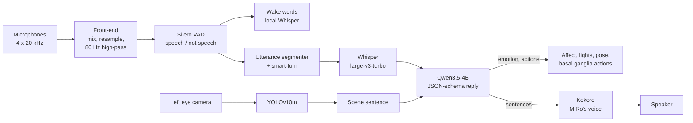
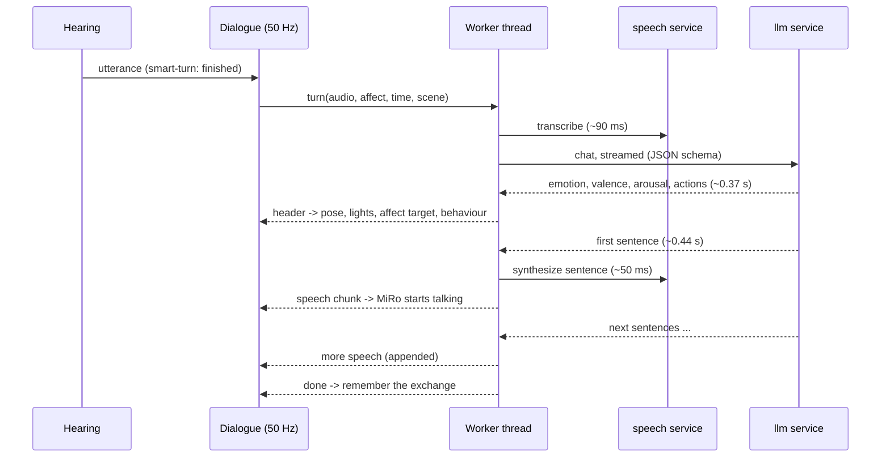

# Hey MiRo: technical documentation

How the local conversation and scene-awareness pipeline is built, which models it uses and why, how each stage
works, and how fast and accurate each stage is (all numbers measured). The how-to-run guides are
[RUN_SIMULATOR.md](RUN_SIMULATOR.md) and [RUN_ROBOT.md](RUN_ROBOT.md). The design of the local services is in
[local_ai.md](local_ai.md), and the comparison with the HRI '25 code is in [hri25_parity.md](hri25_parity.md).

**Contents**

1. [Overview](#1-overview)
2. [Where everything runs](#2-where-everything-runs)
3. [Audio front-end: from microphones to clean frames](#3-audio-front-end-from-microphones-to-clean-frames)
4. [Voice activity detection (VAD)](#4-voice-activity-detection-vad)
5. [Wake words](#5-wake-words)
6. [End of turn](#6-end-of-turn)
7. [Speech-to-text](#7-speech-to-text)
8. [The language model](#8-the-language-model)
9. [Text-to-speech](#9-text-to-speech)
10. [Putting a turn together: streaming and latency](#10-putting-a-turn-together-streaming-and-latency)
11. [Scene awareness: YOLO, gestures and scene context](#11-scene-awareness-yolo-gestures-and-scene-context)
12. [How it fits MiRo's brain-inspired architecture](#12-how-it-fits-miros-brain-inspired-architecture)
13. [GPU memory](#13-gpu-memory)
14. [Benchmarks: method, reproduction and caveats](#14-benchmarks-method-reproduction-and-caveats)

---

## 1. Overview

MiRo listens, understands, decides what to say and what to do, and answers in its own voice, all on one PC:



**Design goals**, in order:

1. **Fast:** MiRo should react within about a second of the person stopping. The paper's cloud version waited 3 s of
   silence, then 0.5–5 s for the cloud.
2. **Reliable:** the robot must never be stuck by a bad model output, a slow service, or a noisy room.
3. **Private and offline:** no audio or video leaves the computer, and no API keys or internet are needed after
   setup.
4. **Fit the existing architecture:** the new parts sit in the forebrain and *modulate* MiRo's stock brainstem; they
   don't replace it.

**Measured result** on an RTX 4070 Ti (details in [section 10](#10-putting-a-turn-together-streaming-and-latency)):
from the moment the person's voice stops, MiRo reacts in 0.4–0.5 s to a wake word or "stop", and starts answering
a question in 0.9–1.2 s.

---

## 2. Where everything runs

| Process / container | Language, base | Runs | GPU |
|---|---|---|---|
| **ROS container**, main client (`client_demo.py`) | Python 3.8, ROS Noetic, MiRo MDK | the 50 Hz brain loop, hearing (VAD, segmenter, wake words), dialogue, voice output | no |
| ROS container, `- scene` client | same | YOLO, mediapipe gestures | yes (YOLO) |
| ROS container, `- caml`/`- camr`/`- mics` clients | same | stock MiRo face/ball/AprilTag detection, sound localisation | no |
| **`speech` service** (`docker/local-ai/speech`) | Python 3.12, FastAPI, CUDA | Whisper (speech-to-text), Kokoro (text-to-speech), smart-turn | yes (Whisper, Kokoro) |
| **`llm` service** (`docker/local-ai`, llama.cpp) | C++ | Qwen3.5-4B | yes |

**Why separate containers:** ROS Noetic requires Python 3.8, while current speech and LLM software needs 3.10 or
newer and a recent PyTorch/CUDA. The services talk **OpenAI-compatible HTTP** on `127.0.0.1`, so the robot code uses
the same client for local and cloud (`ai.provider: local | cloud`). Only the base URL changes.

**Why the scene client is a separate process:** YOLO and mediapipe would compete with the 50 Hz brain loop for
Python's global interpreter lock. In their own process they cannot slow the loop down.

**Threads in the main client:** the 50 Hz tick never waits for anything slow:

- the microphone callback only queues frames;
- a hearing thread runs the VAD, the segmenter and the wake-word segmenting;
- a wake-word thread does one transcription at a time;
- two cloud-worker threads run whole conversation turns (speech-to-text → LLM → text-to-speech);
- the sound card's callback mixes speech and music.

Results carry an *episode/turn token*, so an answer that arrives after the conversation has moved on (the person said
"stop", a dance started) is ignored.

---

## 3. Audio front-end: from microphones to clean frames

`core/node_hearing.py`, `core/audio_util.py`

MiRo publishes `sensors/mics` 40 times a second, each message holding 4 channels × 500 samples at 20 kHz:

- channel 0: left ear;
- channel 1: right ear;
- channel 2: centre;
- channel 3: tail.

In the simulator, or with `--ext-mic`, `tools/host_audio_bridge.py` publishes the computer's microphone in exactly
the same format on `host/mics`.

| Step | What it does | Why |
|---|---|---|
| 1. Channel mix | mean of the two ear channels (`hearing.miro_channels: [0, 1]`) | Averaging two microphones keeps the voice (correlated) and averages down uncorrelated noise (about +3 dB SNR). The HRI '25 code *summed* channels in int16 and could overflow. |
| 2. Gain | `hearing.gain` (default 1.0) | for quiet microphones |
| 3. Resample 20 → 16 kHz | stateful polyphase filter (ratio 4/5, Kaiser-windowed sinc; flat to 6.4 kHz, −60 dB at 8 kHz) | VAD and Whisper expect 16 kHz. A proper filter removes aliasing that the HRI '25 `np.interp` decimation let through. |
| 4. **High-pass filter, 80 Hz** | 2nd-order Butterworth biquad (`audio_util.HighPass`, `hearing.highpass_hz: 80`) | Removes wheel/motor rumble, handling noise and mains hum. Voices start around 100 Hz and their intelligibility lies much higher, so nothing useful is lost. |
| 5. Framing | 512-sample frames (32 ms) | the frame size of Silero VAD, Porcupine and Cobra |
| 6. **Self-hearing guard** | the microphones are ignored while MiRo speaks and for 0.3 s after (0.6 s in the simulator, `hearing.self_hearing_guard_s`), and the pre-roll is cleared | Without echo cancellation, MiRo would otherwise hear and answer itself. |
| 7. Touch noise (robot mics only) | per channel: a high peak *and* a high zero-crossing rate means scratching right on an ear or the tail (`forebrain/touch_noise.py`) | drives the "Ouch!" reactions |

**What is deliberately *not* done: spectral noise suppression.** Classic noise suppressors (spectral subtraction,
RNNoise, DeepFilterNet) improve how speech *sounds*, but they add artefacts that often make speech recognition
*worse*. Whisper was trained on millions of hours of real-world, often noisy, audio and is very robust to noise. Our measurements agree:

- **Whisper:** its error rate stays at 4–5% down to 0 dB SNR for white noise and rumble, with or without the
  high-pass ([section 7](#7-speech-to-text)).
- **The 80 Hz high-pass** matters for the parts that measure *energy*. With motor rumble at 5 dB, it turns the energy
  VAD from useless (99% false alarms) into accurate (F1 0.96, 3% false alarms) ([section 4](#4-voice-activity-detection-vad)).
- **The real problem is other voices** (babble): no front-end filter can tell the person talking to MiRo from the
  person behind them. The system copes in four ways:
  1. **wake words**, so MiRo only listens when addressed;
  2. **a close microphone**, `./run_robot.sh --ext-mic` with a directional or USB microphone near the speaker, as at
     the HRI '25 demo;
  3. **Whisper's own no-speech probability**, which rejects segments that are not clear speech;
  4. **conversation timeouts**, so MiRo stops listening when nobody addresses it.

  In the simulator, headphones (or PulseAudio's `module-echo-cancel`, see [simulation.md](simulation.md)) stop MiRo
  hearing its own voice.

---

## 4. Voice activity detection (VAD)

`core/forebrain/wakeword.py` (`SileroVad`, `EnergyVad`), `core/forebrain/segmenter.py`

The VAD gives every 32 ms frame a **probability that it contains speech**. Everything downstream is gated by it:
- the wake-word spotter only transcribes voiced segments;
- the segmenter only records when someone speaks;
- the dialogue nods when speech starts.

**Silero VAD v5** (MIT licence, pip `silero-vad`) is a small neural network, about 2 MB, run as TorchScript on the
CPU in the ROS container. It looks at one 512-sample frame at a time and keeps a short internal state from frame to
frame, so it reacts within a frame or two and holds steady over short gaps between words. Only the model file is
used, loaded directly with `torch.jit.load`, so the package's other dependencies (torchaudio) are not needed.

The fallbacks, chosen with `ai.local.vad`:

- **`energy`:** frame level in dBFS through a soft step at −38 dBFS, smoothed. It needs no model, but it is only
  usable in quiet rooms.
- **`cobra`:** Picovoice Cobra, the paper's VAD, which needs an access key.

**How the probabilities become an utterance** (the segmenter, settings under `hearing.*`):

| Rule | Value | Effect |
|---|---|---|
| speech threshold | `vad_threshold: 0.6` | a frame with p ≥ 0.6 is voiced |
| onset | `onset_frames: 3` (96 ms) | 3 voiced frames in a row start an utterance, so clicks and taps don't |
| pre-roll | `preroll_s: 0.5` | the 0.5 s before the onset is kept, so the first syllable isn't cut |
| re-onset gap | 0.5 s | a new "voiced" event (nod) needs half a second of silence first |
| end | smart-turn, or `end_silence_s` | see [section 6](#6-end-of-turn) |
| nobody speaks | `no_speech_timeout_s: 3.0` | the conversation ends (as in the paper) |
| too long | `max_utterance_s: 20` | the recording is cut and sent anyway |

All timing is counted in **audio samples**, not wall-clock time, so it is correct even when the simulator runs slower
than real time.

**Benchmark:** 10 sentences, 2 voices, with 0.5 s of silence before and 0.8 s after. Each 32 ms frame is scored
against the clean signal (speech = louder than −45 dBFS). F1 = how well speech frames are found; false alarms = the
share of silent frames called speech.

| Noise | SNR | Silero F1 | Silero false alarms | Energy F1 | Energy false alarms |
|---|---|---|---|---|---|
| white | clean | 0.96 | 5% | 0.95 | 0% |
| white | 20 dB | 0.97 | 4% | 0.96 | 0% |
| white | 10 dB | 0.96 | 5% | 0.76 | 47% |
| white | 5 dB | 0.95 | 6% | 0.61 | 98% |
| white | 0 dB | 0.95 | 5% | 0.61 | 99% |
| rumble | 10 dB | 0.96 | 5% | 0.79 | 41% |
| rumble | 5 dB | 0.96 | 5% | 0.61 | 98% |
| rumble | 0 dB | 0.95 | 6% | 0.61 | 99% |
| babble | 20 dB | 0.93 | 10% | 0.96 | 0% |
| babble | 10 dB | 0.82 | 32% | 0.83 | 30% |
| babble | 5 dB | 0.68 | 72% | 0.65 | 83% |
| babble | 0 dB | 0.63 | 93% | 0.62 | 97% |

**The 80 Hz high-pass and the energy VAD** (rumble):

| SNR | without high-pass | with 80 Hz high-pass |
|---|---|---|
| 20 dB | F1 0.96, 0% false | F1 0.95, 0% false |
| 10 dB | F1 0.79, 39% false | F1 0.96, 0% false |
| 5 dB | F1 0.61, 99% false | F1 0.96, 3% false |

**CPU time per frame:** Silero 0.42 ms and energy 0.01 ms. One frame lasts 32 ms, so Silero uses about 1.3% of one
core.

**Reading the results:**

- **Silero is unaffected by hiss and rumble down to 0 dB**, where the energy detector fails completely.
- Silero's constant ~5% "false alarms" are mostly frames right after a word, where it deliberately stays "on" over
  short gaps. That is the behaviour you want for segmenting speech.
- **Other voices are speech, so every VAD fires on them**: babble is handled by the measures in
  [section 3](#3-audio-front-end-from-microphones-to-clean-frames), not by the VAD.

---

## 5. Wake words

`core/forebrain/wakeword.py` (`AsrKeywordSpotter`, `match_wake_phrase`), `core/node_hearing.py`

MiRo responds to **"Hey MiRo"** (start a conversation), **"Dance MiRo"** (dance now) and **"Stop MiRo"** (stop
everything). The paper used Picovoice Porcupine, a dedicated keyword model that needs an account and an access key.
The local pipeline recognises the phrases with **the same Whisper model that does speech-to-text**:

1. **Segment:** the voiced stretches found by the VAD are cut out:
   - onset: 2 voiced frames;
   - plus 0.3 s of pre-roll;
   - ends after 0.35 s of silence, or at 2.5 s at most.
2. **Transcribe:** each segment goes to Whisper with a spelling hint (`"Hey MiRo! Dance MiRo! Stop MiRo!"`), so the
   name comes out as "MiRo". This happens on a background thread, one segment at a time, keeping only the newest
   waiting one.
3. **Reject non-speech:** results where Whisper's own `no_speech_prob` is above 0.6 are dropped.
4. **Match:** the text is matched against the phrases, tolerating how speech recognition writes "MiRo":
   - a lead word (`hey`/`hi`/`hello`/`okay`, `dance`, `stop`) within 3 words of a MiRo-like word;
   - MiRo-like means one of: miro, mirror, milo, meero, mero, nero, … or anything at least 75% similar to "miro";
   - MiRo then the lead word ("MiRo, stop!") also counts.
5. **Mask:** what is listened for depends on what MiRo is doing. While it is talking or dancing, only "Stop MiRo"
   counts. Then speech longer than 1.5 s is not transcribed at all: a stop command is short, and the person's
   sentences are already being transcribed for the conversation. This avoids transcribing everything twice; it
   measured about 20% faster turns on a CPU.
6. A detection goes straight to the hearing node's event queue, and the forebrain starts the conversation, the dance
   or the stop.

**Why this instead of a dedicated keyword model:**

- no account and no per-word training;
- any phrase can be added in code;
- with Whisper already loaded on the GPU, it costs about 90 ms per segment.

The price is that MiRo reacts *after* the phrase (when the segment ends) rather than during it. That is still
0.4–0.5 s in total ([section 10](#10-putting-a-turn-together-streaming-and-latency)). `ai.local.wake_word: porcupine`
switches back to Porcupine if you have a key.

**Benchmark:** 5 wake phrases and 6 similar non-wake sentences ("Hey there", "I like mirrors", "My friend Milo is
here", …). White noise and babble are pooled.

| SNR | Wake phrases recognised | False wakes | Latency (p50) |
|---|---|---|---|
| clean | 5/5 | 0/6 | 89 ms |
| 10 dB | 10/10 | 0/12 | 88 ms |
| 5 dB | 9/10 | 0/12 | 88 ms |
| 0 dB | 9/10 | 0/12 | 88 ms |

---

## 6. End of turn

`docker/local-ai/speech/server.py` (`/v1/turn`), `core/cloud/tts.py` (`TurnDetector`), `core/forebrain/segmenter.py`

Deciding when a person has *finished* is the biggest single delay in a voice conversation. The paper waited a fixed
~3 s of silence. Waiting less makes MiRo interrupt people who pause to think.

The pipeline uses **smart-turn v3.2** (BSD-2, `pipecat-ai/smart-turn-v3`), a model trained for exactly this
question:

- **How it decides:** it listens to *how* the speech ended (intonation, rhythm, trailing words), not just to the
  silence.
- **Model:** the encoder of Whisper-tiny with a small classifier on top, 8 M parameters, int8 ONNX, on the CPU.
- **Input and output:** it takes the last 8 s of the utterance and returns a probability that the turn is complete.

**How it is used:**

| Rule | Value |
|---|---|
| first check | after `turn_min_silence_s: 0.3` s of silence |
| further checks | every 0.3 s of continuing silence |
| "finished" if | probability ≥ `turn_threshold: 0.9` |
| give up waiting | `end_silence_s: 1.2` s of silence (fallback; the paper used ~3 s) |

The check runs on the hearing thread (about 17 ms), never in the 50 Hz loop. If the service doesn't answer, the
segmenter simply falls back to the 1.2 s silence. `ai.local.end_of_turn: silence` restores the paper's behaviour.

**Benchmark** (`tools/bench_pipeline.py --only turn`, plus a threshold sweep):

| Case | Probability "finished" |
|---|---|
| finished sentences (10) | 0.97–0.99, every one |
| sentences cut off at 40/55/70% (32) | spread from 0.01 to 1.0 |

| Threshold | Finished recognised | Cut-off recognised as unfinished |
|---|---|---|
| 0.5 | 10/10 | 10/32 |
| 0.9 (default) | 10/10 | 14/32 |
| 0.95 | 10/10 | 16/32 |

**Interpretation and limits:**

- **The threshold.** Finished speech scores ≥ 0.97, so raising the threshold to 0.9 costs nothing on finished
  sentences. When smart-turn is unsure, MiRo just waits the 1.2 s fallback, so the high threshold only makes MiRo
  more patient.
- **A pessimistic test.** Cutting synthesized sentences in the middle is a crude stand-in for a real person pausing
  mid-thought. The cut audio has the sentence's own intonation up to an abrupt stop, which the model often reads as
  an ending. Real pauses ("I like… um… dancing") carry clearer "not finished" cues.
- **To be measured.** Recordings of real users would give the true numbers; this is the main open evaluation.

---

## 7. Speech-to-text

`docker/local-ai/speech/server.py`, `core/cloud/llm.py` (`OpenAIClients.transcribe`)

**Model: Whisper large-v3-turbo** (OpenAI, MIT), converted to CTranslate2 (`deepdml/faster-whisper-large-v3-turbo-ct2`)
and run by **faster-whisper** with int8 weights and float16 activations (`int8_float16`) on the GPU.

- **The model:** 809 M parameters, the large-v3 encoder with its decoder cut from 32 to 4 layers. It is almost as
  accurate as large-v3 and much faster.
- **Settings:**
  - `beam_size 1`;
  - `language en`;
  - `condition_on_previous_text off`, so a mistake cannot carry into the next segment;
  - no timestamps;
  - no built-in VAD (the audio is already segmented);
  - the spelling hint `"MiRo"` for conversation turns.
- **Guards:** segments Whisper hallucinates from near-silence ("you", "thank you.", "thanks for watching!") are
  treated as nothing heard.

**Latency against utterance length** (GPU):

| Utterance | Latency (p50) | Real-time factor |
|---|---|---|
| 1 s | 86 ms | 0.086 |
| 3 s | 89 ms | 0.030 |
| 6 s | 97 ms | 0.016 |
| 10 s | 108 ms | 0.011 |

That is almost constant, about 90 ms: Whisper always encodes a 30 s window, and the decoder is tiny. On the CPU, the
same 3 s utterance takes about 3.7 s.

**Accuracy in noise:** word error rate over 10 sentences and 2 voices. The 4.0% floor is "colour" vs "color" and
similar spelling, not mistakes:

| Noise | Clean | 20 dB | 10 dB | 5 dB | 0 dB |
|---|---|---|---|---|---|
| white | 4.0% | 4.0% | 4.0% | 4.0% | 5.4% |
| rumble | 4.0% | 4.0% | 4.0% | 4.0% | 4.0% |
| babble | 4.0% | 4.0% | 4.0% | 4.0% | 8.7% (7.2% with the 80 Hz high-pass) |

---

## 8. The language model

`docker/local-ai/compose.yaml` (`llm`), `core/cloud/llm.py`, `core/cloud/tools.py`, `config/persona.md`

**Model: Qwen3.5-4B** (Alibaba Qwen, Apache-2.0), quantised to Q4_K_M GGUF (`unsloth/Qwen3.5-4B-GGUF`, about 2.7 GB)
with its vision projector (`mmproj-F16`, 0.7 GB). It runs in **llama.cpp**'s server with these settings:

| Setting | Value |
|---|---|
| layers on the GPU | all |
| context | 16k tokens, 2 parallel slots (a conversation and an object comment can run together) |
| flash attention | on |
| chat template | the model's own Jinja template |
| reasoning ("thinking") | **off** (`--reasoning-budget 0`, `enable_thinking: false`) |
| prompt cache | **reuse** (`--cache-reuse 256`, `cache_prompt: true`) |

**What one turn sends** (about 1,800 tokens; the order is chosen for the prompt cache):

1. **System prompt:**
   - MiRo's persona (the paper's, `config/persona.md`);
   - the arousal–valence emotion table (the paper's);
   - "what you can do", generated from the action registry;
   - the reply rules, including "mention what your camera sees only when it fits; never claim to see anything you
     were not told about".
2. **Six fixed example exchanges** in the exact reply format. Two of them must **not** trigger an action ("I love
   dancing too", "Your ears are so cute!"), because small models over-trigger tools.
3. **The conversation so far:** up to 10 exchanges, cleared when the conversation ends.
4. **This turn:** `[context]` + the person's words. The context holds:
   - MiRo's current valence and arousal;
   - the time;
   - the scene sentence (see [section 11](#11-scene-awareness-yolo-gestures-and-scene-context)).

   It is put in front of the person's words, not in a second system message. Qwen's template rejects a second system
   message, and the context changes every turn, so it must come *after* everything cacheable.

**Structured output = reliable tool calls.** The reply must match a **JSON Schema** that llama.cpp compiles into a
grammar, so the model *cannot* write anything else:

```json
{"emotion": "happy", "valence": 0.9, "arousal": 0.85,
 "actions": [{"tool": "dance", "song": "Dancing Queen - ABBA"}],
 "reply": "YES! I LOVE ABBA! Let's dance!"}
```

- `emotion` is one of 6; `valence` and `arousal` are numbers.
- `actions` holds at most 2 of: spin, move_ears, impression, sleep, dance(song), tricks, identify_object.
- `song` is one of the bundled songs or `"any"`.
- `reply` is at most 240 characters.

The schema, the prompt's list of actions and the code that executes them are all generated from **one registry**
(`cloud/tools.py`), so they cannot disagree. The fields are generated in this order so the **body can react before
the first word is spoken** (next section). A lenient parser still accepts free text and the paper's "Key: value"
format, so a cloud model without schema support also works.

**Sampling:** Qwen's settings for non-thinking mode, temperature 0.7, top-p 0.8, top-k 20; at most 200 new tokens.

**Benchmark** (`tools/bench_pipeline.py --only llm`):

| Measure | Value |
|---|---|
| prompt size | 1,823 tokens |
| prompt processing without cache | 265 ms (6,900 tokens/s) |
| prompt processing with cache (only the new turn) | **60 ms** |
| generation speed | 128 tokens/s |
| typical reply | 58 tokens |
| time to the emotion + actions ("header") | 0.37 s (p50) |
| time to the first sentence | 0.44 s (p50) |
| whole reply | 0.50 s (p50) |

**Decision quality** (`tools/eval_dialogue.py`, 40 scripted messages: chit-chat, each action, near-misses, garbled
speech recognition):

| Measure | Qwen3.5-4B | Qwen3.5-9B |
|---|---|---|
| valid JSON in schema order | 40/40 | 40/40 |
| right action(s) and song | 38/40 | 38/40 |
| action F1 | 0.95 | 0.96 |
| time to first sentence (p50) | 0.44 s | 0.69 s |
| GPU memory (both AI services) | ~7 GB | 9.5 GB |

The usual misses are borderline cases. For example, "I'm so tired, I want to sleep" made MiRo nap too. Before the
negative examples and the "talking about it is not a request" rule, 4B scored 36/40 with three false triggers. 9B is
not more accurate here, only slower, so 4B is the default (`--local-ai 9b` on the robot for richer chat).

---

## 9. Text-to-speech

`docker/local-ai/speech/server.py`, `core/cloud/tts.py` (`OpenAISpeech`), `core/node_voice.py`

**Model: Kokoro-82M** (hexgrad, Apache-2.0):

- **Architecture:** an 82 M-parameter text-to-speech model based on the StyleTTS 2 architecture, producing 24 kHz
  audio.
- **Reading words:** text is turned into phonemes by misaki, with espeak-ng for unknown words. Voices are small style
  vectors.

**MiRo's voice.** The paper chose a higher-pitched voice to suit MiRo's size. MiRo uses `af_heart`, raised by a pitch
factor *k* = 1.15:

1. Synthesize at speed / *k*: the speech comes out *k* times longer.
2. Resample by 1 / *k*: playing *k* times faster makes the pitch *k* times higher.

The duration comes back to normal, and no extra model is needed. The Mickey Mouse impression uses `af_sky` at
*k* = 1.45.

**Streaming:** the speech service synthesizes **one sentence at a time** and streams raw 16-bit PCM. The robot appends
each sentence to the speech channel as it arrives (`NodeVoice.say_pcm(append=True)`). MiRo speaks the first sentence
while the LLM is still writing the second.

**Benchmark** (GPU, one request):

| Sentence | Audio length | Synthesis (p50) | Real-time factor |
|---|---|---|---|
| 2 words | 1.43 s | 24 ms | 0.017 |
| 10 words | 3.70 s | 49 ms | 0.013 |
| 21 words | 7.02 s | 50 ms | 0.007 |

---

## 10. Putting a turn together: streaming and latency

`core/forebrain/dialogue.py` (`TurnRunner`, `DialogueMachine`), `core/cloud/llm.py` (`ReplyStream`)

A conversation turn is **one job on a worker thread** that reports progress on a queue while it runs:



- **`ReplyStream`** parses the JSON *while it streams*. When the `actions` list closes, it knows the emotion and the
  actions; it then decodes the `reply` string sentence by sentence (sentences of at least 20 characters). If the
  model ignored the format, the full text is parsed at the end instead.
- **Speaking starts at the first sentence**, after the "hmm" clip if one is playing. The waiting tune only plays
  while there is nothing to say yet.
- **A dance hands over at once:** the reply is not spoken, and the dance intro clip plays instead, as in the paper.

**End-to-end latency** in Gazebo (`tools/fake_user.py`), measured **from the moment the person's voice stops** until
MiRo visibly reacts. This includes deciding that they have finished:

| The person says | MiRo | After (GPU) | After (CPU only) |
|---|---|---|---|
| "Hey MiRo!" | greets | 0.38 s | 5.2 s |
| "Hi! What is your favourite band?" | starts answering | 0.91 s | 14.9 s |
| "Can you spin around for me?" | starts answering and spins | 1.20 s | 13.7 s |
| "Can you dance to Dancing Queen?" | starts dancing | 1.23 s | 14.3 s |
| "Stop MiRo!" | stops, says goodbye | 0.46 s | 5.1 s |

**Where the ~1 s goes** (GPU, typical question; estimated from the stage benchmarks above):

| Stage | Time |
|---|---|
| end of turn (≥ 0.3 s of silence + smart-turn check) | ~0.32 s |
| speech-to-text | ~0.09 s |
| LLM to the first sentence (cached prompt) | ~0.44 s |
| text-to-speech of that sentence | ~0.05 s |
| audio output buffer and state changes | ~0.1 s |

The paper's cloud pipeline took about 3 s of fixed silence, then 0.5–5 s (up to 20 s on poor Wi-Fi).

---

## 11. Scene awareness: YOLO, gestures and scene context

`core/node_scene.py` (the `- scene` client), `core/forebrain/scene_context.py`, `core/node_forebrain.py`
(`compute_scene_mode`), `core/action/action_identify.py`, `core/action/action_tricks.py`

### 11.1 The scene client

A separate process (`client_demo.py - scene`) watches MiRo's **left eye camera** (`sensors/caml/compressed`,
640 × 360 JPEG). The main client tells it what to look for on `core/scene/mode`, re-sent every second:

| Mode | When | Models | Publishes |
|---|---|---|---|
| `off` | nothing needs vision | none; the camera is not even subscribed (saves Wi-Fi bandwidth) | — |
| `objects` | the object game ("guess what I'm holding") | YOLO, the 13 game classes (`identify.classes`) | `core/scene/objects` |
| `gestures` | tricks | mediapipe GestureRecognizer | `core/scene/gesture` |
| **`context`** | **any conversation** (`features.scene_context`) | YOLO, all 80 COCO classes (`scene.context_classes: []`) | `core/scene/objects` |

If main stops sending the mode for 3 s, the client falls back to `off`. Frames older than 1 s are skipped. The models
are loaded on first use, and if one fails, the other keeps working.

**YOLOv10m** (Ultralytics, trained on COCO's 80 everyday classes: people, cups, phones, books, dogs, chairs, …):

- **Settings:** confidence ≥ 0.4, run at `scene.rate_hz` (5 Hz on the robot, 1 Hz in the simulator so Gazebo keeps
  its GPU time).
- **Confirmation:** an object counts as *confirmed* when it was seen in **4 of the last 10 frames**
  (`identify.confirm`, as in HRI '25), which filters out single-frame mistakes.
- **No non-maximum suppression:** YOLOv10 is "NMS-free", so it outputs one box per object without that post-processing
  step, which is part of why it is fast.

**Gestures:** mediapipe's GestureRecognizer (hand landmarks + classifier, CPU):

- **Smoothing:** a gesture must be seen in 3 of the last 5 frames.
- **Ignored:** Closed_Fist and both thumbs, as in HRI '25.
- **Tricks:** Open_Palm → greet and nod, Pointing_Up → spin, Victory → ear wiggle, ILoveYou → party lights.

**Benchmark** (640 × 360 frames, all 80 classes):

| Model | Device | Per frame (p50) | Frames/s |
|---|---|---|---|
| YOLOv10m (used) | GPU | 3.7 ms | 273 |
| YOLOv10n | GPU | 2.9 ms | 340 |
| YOLOv10m | CPU | 63 ms | 16 |
| YOLOv10n | CPU | 15 ms | 66 |
| mediapipe gestures | CPU | 9.3 ms | ~100 |

The very first YOLO call takes ~0.5 s (CUDA start-up). At 5 Hz, YOLOv10m uses under 2% of the GPU's time. On a
computer without a GPU, `scene.yolo_weights: yolov10n.pt` keeps the scene client light.

### 11.2 Scene context: YOLO as text, not image tokens

While MiRo is in a conversation, the scene client runs in `context` mode, and **what MiRo sees is given to the LLM
as one short sentence of text**. `forebrain/scene_context.py` builds it from the latest objects message:

```
Your camera sees: a person in front of you, a cup on your left.
Your camera sees: two people, a tie in front of you.
```

How the sentence is built:

- only **confirmed** objects (4 of 10 frames), at most 4, the most confident first;
- **position** from the box centre: left third → "on your left", middle → "in front of you", right third → "on your
  right";
- **"right in front of you"** when the box covers more than a quarter of the image, meaning the object is close;
- **counts** for repeated objects ("two people"); then no position is given, since the objects may be in different
  places;
- nothing if the newest message is older than 3 s.

The sentence goes into the turn's `[context]`. The system prompt tells MiRo to use it only when it fits, and never to
claim to see anything it was not told about.

**Why text and not the camera image?** Qwen3.5 *is* a vision-language model and could look at the frame itself, but:

| What the LLM gets per turn | Extra prompt tokens | Time to process the prompt |
|---|---|---|
| the 640 × 360 camera frame (vision encoder + image tokens) | 222 | 135 ms |
| YOLO's sentence ("a person in front of you, a cup on your left") | 19 | 51 ms |

(Measured with `tools/bench_pipeline.py --only vision`; YOLO itself adds 3.7 ms, in another process.)

- **Faster every turn:** the image costs about 12× more tokens and ~85 ms more on *every* answer. The frame changes
  every turn, so it can never be served from the prompt cache.
- **Steadier and more trustworthy:** YOLO's output is confirmed over several frames, so a passing blur doesn't become
  "I see a dog!". The model is told only things that were actually detected, which limits hallucination.
- **Cheaper in memory and bandwidth:** the camera is already decoded for YOLO, and the conversation context stays
  small (the 16k context holds a long conversation).
- **Grounded in the architecture:** like the stock MiRo, perception is done by dedicated "midbrain" detectors, and the
  forebrain reasons over their *results*.

**The trade-off:** MiRo only knows the 80 COCO classes and where they are. It cannot read text, name colours, or say
what a drawing shows. For such questions, sending a single frame to the vision-language model would be a natural
extension; it is not implemented.

**Example** (real photos through the real code; `scene.device` GPU):

| Camera sees (YOLO) | Person asks | MiRo answers |
|---|---|---|
| "two people, a tie in front of you" | "What can you see right now?" | "Ah, I see two people and a tie! What do you think of that?" |
| "a person on your left" | "What can you see right now?" | "I see a person on my left! Is that you, my friend?" |
| "a person on your left" | "Do you like dogs?" | "Hmmm, I like many animals! But I'm jealous of birds because they fly. What about dogs?" (the scene is not dragged in) |

In the Gazebo arena the camera mostly sees walls and a ball. The scene sentence is then empty, and MiRo says
nothing about the scene.

---

## 12. How it fits MiRo's brain-inspired architecture

The stock MiRo controller (Mitchinson & Prescott, 2016) is layered like a vertebrate brain:

- **spinal cord:** reflexes;
- **brainstem:** affect, expression and spatial attention;
- **basal ganglia:** action selection.

Everything above sits in the **forebrain** and *modulates* these layers instead of commanding the motors directly:

| Forebrain output | How it reaches the lower layers |
|---|---|
| reply emotion, valence, arousal | `affect.set_forebrain_target()` pulls MiRo's affect toward them; lights and pose follow through the stock expression system |
| actions (dance, tricks, identify) | a request on the forebrain's task board; the action wins in the **basal ganglia** with priority 0.84 (0.89 while running), above orient/approach (≤ 0.8) and below the protective actions (halt and cliff avoidance, 0.9–1.0) |
| spin, ears, impression | flourishes inside the conversation action, borrowing the ears and lights for a few ticks |
| what to listen for | the wake-word mask (only "Stop MiRo" while busy) |
| what to look for | the scene mode (`off`, `objects`, `gestures`, `context`) |
| MiRo speaking | counted as vocalising, so MiRo's own sound doesn't drive its auditory attention |

So MiRo keeps all of its animal-like behaviour (exploring, orienting to faces and sounds, reacting to touch, cliff
reflexes), and language is one more source of goals.

---

## 13. GPU memory

| Configuration | GPU memory used (RTX 4070 Ti, 12 GB, desktop included) |
|---|---|
| AI services only (Qwen3.5-4B + Whisper + Kokoro) | ~7.0 GB |
| + Gazebo, camera clients, YOLOv10m (full simulator demo) | 7.9 GB |
| AI services with Qwen3.5-9B (robot, no Gazebo) | 9.5 GB |

---

## 14. Benchmarks: method, reproduction and caveats

**Machine:** RTX 4070 Ti (12 GB), 24-thread desktop CPU, Ubuntu 24.04, NVIDIA driver 580, Docker 29. The models are
the pinned revisions in `docker/local-ai/models.env`.

**Reproduce** (AI services running; inside the MiRo container started with the GPU):

```bash
python3 tools/bench_pipeline.py --images <folder of photos> --weights yolov10m.pt,yolov10n.pt --json bench.json
python3 tools/eval_dialogue.py --json eval.json
python3 tools/fake_user.py --log run.json          # with ./run_sim.sh --no-bridge running
```

**How the audio tests are made:**

- **Speech** is synthesized by the speech service (Kokoro voices `am_michael` and `bf_emma`, not MiRo's), so the
  correct text is known.
- **Noise** is added at a known signal-to-noise ratio:
  - *white*: broadband hiss;
  - *rumble*: tones at 32/55/90/130 Hz plus low-passed noise, like motors and wheels;
  - *babble*: three other synthesized voices talking over each other.
- **VAD ground truth:** a frame of the clean signal louder than −45 dBFS counts as speech.

**Caveats:**

- **Synthetic speech and noise.** Synthesized speech is clean, clearly articulated and has no room echo, and
  synthetic noise is simpler than a real exhibition hall. Absolute accuracy with real people in real rooms will be
  lower; the comparisons (Silero vs energy, high-pass on/off, CPU vs GPU, 4B vs 9B) are what these numbers are good
  for.
- **smart-turn.** Its "unfinished" test (sentences cut mid-way) is a crude stand-in for real pauses (section 6).
- **Small samples.** 10 sentences, 40 dialogue cases and two photos are small. Treat differences of one or two cases
  as noise.
- **What is still missing:** an evaluation with recordings of real users, on the robot, in a noisy room.
